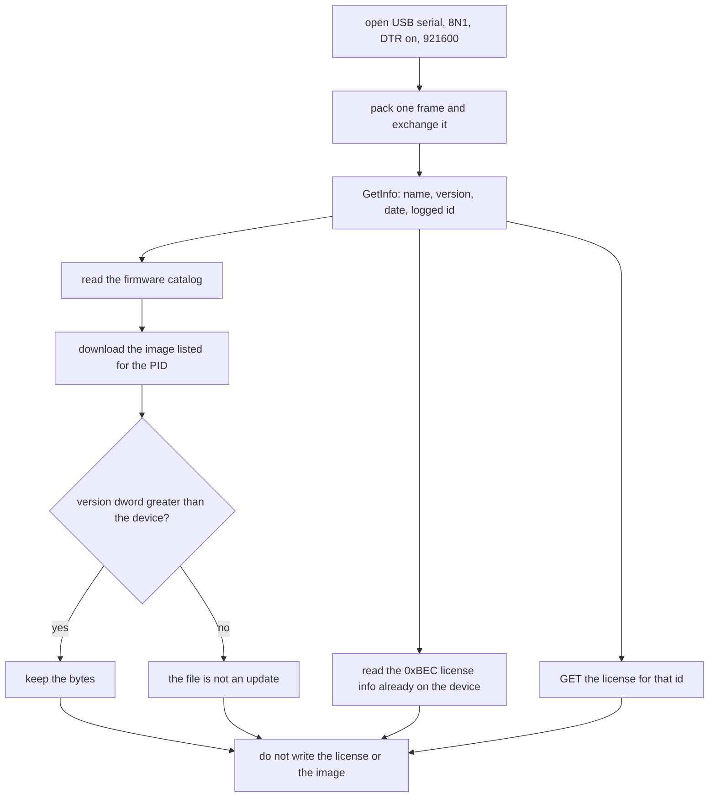
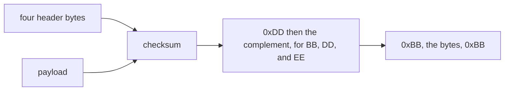
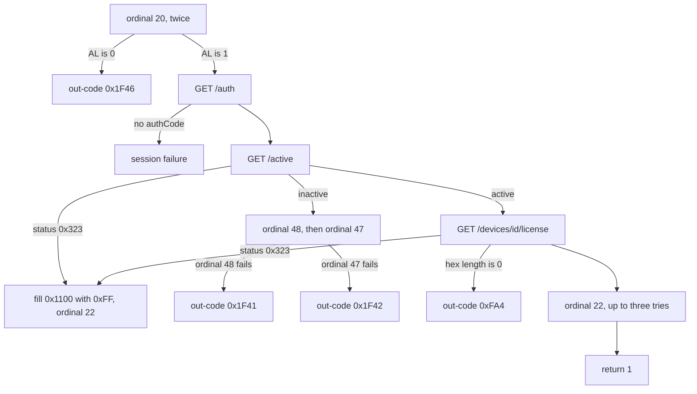
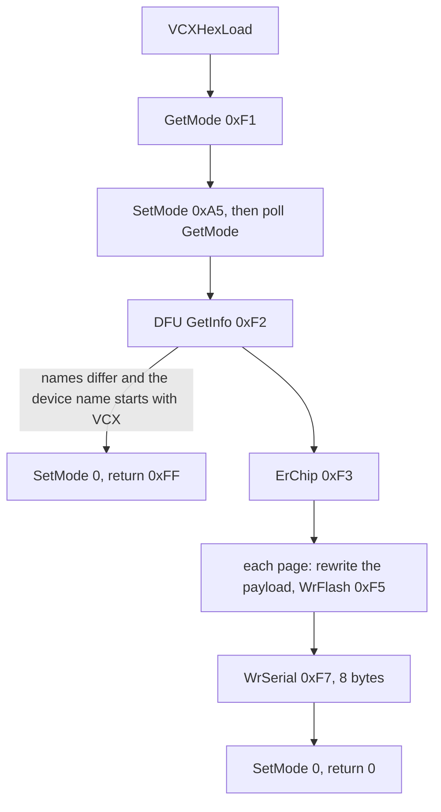

# Protocol

What this crate sends, and the update sequence it does not send.
The pass-through reads are planned in [reads.md](reads.md).

The frame and `GetInfo` were checked on COM4 on 2026-11-20. The update sequence was
read from `ManagerCenter.exe` (image base `0x400000`) and from `vcx-reconstructed.dll`
(image base `0x7B2F0000`). No step of that sequence was sent to the dongle, and no
license secret is recorded here. The command bytes inside ordinals 20, 21, and 22
were not recovered. Those exports jump into a virtualized section, and this note
does not invent a frame for them.

## What this crate does

A retrieved license is the server body. It is not the `0xBEC` buffer ordinal 21
returns, and it is not written back. `newer_firmware` is stricter than the manager:
the manager arms an update when the catalog version string differs at all, and the
DLL still enters the boot mode when the device version dword is greater.

## The wire frame

`VCXCommSendFrame` (`0x7B2F9F20`) fills an internal buffer, then escapes it.

| Offset | Contents |
|---|---|
| 0 | `0x80` |
| 1 | `0x00` for the device commands, or a caller byte for `VCX_PRO_Send` |
| 2 | command |
| 3 | `0x00`, or the caller channel |
| 4 | payload length, a little-endian `u32`, refused above `0x1026` |
| 8 | checksum |
| 9 | payload |

The checksum starts at header byte 2. When byte 0 is `0x80` it adds `byte 3 - 0x80 + byte 1`.
Payload bytes are then added, two per step, and a leftover odd byte is added on its own.
For a header `80 00 cmd 00` that is `(cmd - 0x80 + sum of the payload) mod 256`. The empty
`GetInfo` request is `80 00 8C 00` and the checksum byte is `0x0C`.

The escape reads the four header bytes, then the payload, then the checksum, and wraps
that stream in `0xBB`. A live `GetInfo` answer on 2026-11-20 matched this sum.

## License update, as the manager orders it

`DeviceInfoWnd::UpdateDeviceLicense` (`0x0042BA50`) opens with `VCX_Open` when byte
`device+0x1A91` is clear. A return of `0x7F` sets byte `+0x1A92`. `_ReadHWInfo`
(`0x00441F90`) then calls `VCX_DEV_GetInfo` into 64 bytes, `VCX_DEV_SynExInfo` into
128 bytes, `VCX_GetCommIf`, and ordinal 21 into `0xBEC` bytes at `device+0x128`.
A zero return from ordinal 21 sets byte `+0x1A94`. The logged id is taken from the
`GetInfo` serial only after byte 7 matches the xor of the other seven with `0x82`.

Ordinal 20 is `DAT_004B99B4`. `FUN_00442EA0` clears `0x44` bytes at `device+0xD14`
and stores a 16-byte `SYSTEMTIME` at `+0x00` and a 16-byte GUID at `+0x10`.
`FUN_00442FA0` is SHA-256 of those 32 bytes. The first call passes the block with
the dword at `+0x40` set to 0. On a zero return the manager compares eight dwords,
32 bytes at `device+0xD34`, with that digest. The immediate `0x1C` is the counter
the loop starts from. It steps down by 4 and stops once the counter is no longer
greater than 3, so the compare is 32 bytes. A match stores 1 at `+0x40`, writes the
digest back over those 32 bytes, and calls ordinal 20 again. The DLL export does not
show this sequence. Its body is the jump at `0x7B2F6A30`.

Ordinal 22 is `DAT_004B9928`, called with the handle and a `0x1100`-byte buffer.
The write loop in `UpdateLicense` (`0x00442280`) logs `try write license, time: {n}/3`
with the counter at 1, then 2, then 3. A zero return logs `write license okay`.
After the third failure the counter is 4, the branch at `0x00442D8B` joins
`0x00442DED`, the out-code is cleared, and the function returns 1. A failed write
is reported as success. This crate does not copy that loop.

Status `0x323` on the get-state path, the set-state path, or the download path calls
`EraseLicense` (`0x004421C0`). That fills `0x1100` bytes with `0xFF`, runs the same
ordinal-20 gate, and calls ordinal 22. This crate does not send that buffer.

Ordinals 20, 21, and 22 do not call `VCXCommSendFrame` by a direct call. Their
command bytes, chunk sizes, and per-frame layouts were not recovered. The log names
`VCX_DEV_ReqLicense`, `VCX_DEV_GetLicense`, and `VCX_DEV_SetLicense` have no xref.

## Firmware page records

`VCXHexLoad` (`0x7B2FAEC0`) reads `0x24` bytes, then one packed record per
`Head.PageNum`:

| Offset in the record | Contents |
|---|---|
| 0 | payload length, little-endian `u32` |
| 4 | a second dword, stored and not passed to `WrFlash` |
| 8 | `length` payload bytes |

The in-memory copy uses a stride of `0x410`. The allocation is `0x104024`, which is
the header plus 1024 slots. `PageNum` is the count that is actually walked.
`0x400` is only the capacity.

`read_pages` walks the packed records. A length above `0x1026` is refused. The
VCIA 1.9.4.2 catalog image is 191770 bytes, `Head.PageNum` is 187, and the packed
records consume the file exactly. Their lengths run from 8 to 1030. The second
dword is not the index `0..186`.

## Ordinal 0x27

`GetProcAddress` ordinal `0x27` is export 39 at `0x7B2F9C20`. It is not the named
`VCX_DFU_*` exports, and it is not Ghidra's `Ordinal_27` (that one is
`VCX_DEV_SetLed`). The export tail-calls `VCX_DFU_AutoUpdate` (`0x7B2F97B0`).
`UpdateVCIFirmware` calls it at `0x00435FC1` with the handle, the ANSI path of
`\VCX.bin`, 0, and a progress dword. The 0 does not survive: the function overwrites
that argument with the poll count 10. A zero return is the manager's "firmware has
upgrade" branch, which then calls `UpdateLicense`.

The manager decides to call it by a UTF-16 compare of the catalog `VERSION` with
the running version string (`0x00435566`). Any difference sets byte `window+0x504`.
An equal string skips ordinal `0x27`.

`GetMode` runs first. When its reply byte is already `0xA5`, the function jumps
to the DFU `GetInfo` call and skips the device `GetInfo`, the version compare,
and `SetMode 0xA5`. Otherwise it calls `VCX_DEV_GetInfo` (`0x7B2F8440`). The
device dword in the compare is at offset `0x34` of the buffer that call fills,
which is `DevInfo.FwVersion`. The file dword is at image+`0x0C` (`0x7B2F9905`).
When the device dword is greater it logs `Device FwVersion is New!` and falls
through. The log is not a refusal. `ErChip` and the page loop still run.
`Head.Key` at image+`0x10` is logged and is not an argument of any DFU command.

Each DFU command uses the internal buffer above, with channel `0x00`.

| Command | Byte | Payload |
|---|---|---|
| `SetMode` | `0xF0` | one byte, `0xA5` to enter and `0` to leave |
| `GetMode` | `0xF1` | empty. The reply length must be at least 2 |
| `GetInfo` | `0xF2` | empty. The reply length must be at least `0x21` |
| `ErChip` | `0xF3` | empty. Called once, before the page loop |
| `WrFlash` | `0xF5` | the buffer ordinal 37 is given. No page index is inserted |
| `WrSerial` | `0xF7` | 8 bytes, or the function returns `0x94` |

There is no sender for `0xF4` or `0xF6`. `VCX_DEV_Reset` is not called from this
function. Shared failure returns are `0x80` for a null device, `0x94` for a null
parameter, `0x82` for a send failure, and `0x83` for a receive failure. Success of
the whole update is `0`, at `0x7B2F9C08`. A refused name or a missed boot mode is
`0xFF`.

The 8-byte name check reads offset `0x20` of the buffer DFU `GetInfo` fills and
compares it with `Head.Name`. When the 8 bytes differ and the device bytes begin
`V`, `C`, `X`, the function calls `SetMode` 0 and returns `0xFF`.

Before each `WrFlash`, `0x7B2FAB90` rewrites the page payload at record+8. The
byte length is the record's first dword. The second dword is not an argument.
The key pointer is the DFU `GetInfo` buffer; the round uses its first 16 bytes,
not `Head.Key`. The instruction is `sub ebx, 0x61C88647`. Modulo `2^32` that
adds `0x9E3779B9`, and the mix is added into each little-endian word.
`rewrite_page` is that transform. It runs only when the caller supplies the key.
This crate does not ask the dongle for the buffer.

The `WrFlash` call that follows pushes the dword at the start of the loaded
image, not the page length. Every image `read_header` accepts begins
`A5 A5 A5 A5`, so that dword is `0xA5A5A5A5`. `VCXCommSendFrame` refuses a
payload above `0x1026`. `write_flash` builds the buffer ordinal 37 copies, with
no page index, and refuses a length above `0x1026`. It does not build the
`0xA5A5A5A5` call. `plan_firmware` records that length and `hold` refuses it.

`WrSerial` is called with length 8. The pointer is the stack dword at
`[ESP+0x20]`. The prologue stores 10 there, and no later plain instruction in
this function overwrites it. When that dword is 0 the pointer is `[ESP+0x3C]`,
a slot this function does not write. Neither is a recovered serial, so the plan
does not build the 8 bytes. On that zero-pointer path the function loads 10
into `ESI` and polls `GetMode` until the reply byte is 0. The boot-mode poll,
after `SetMode 0xA5`, decrements a stack dword and stops when the reply byte is
`0xA5`. The plain instructions do not show that dword's initial value. The
indirect calls through `[0x7B2FE0B4]` (immediate `0x1F4`) and `[0x7B2FE13C]`
(immediate `0x1010`) were not resolved to named imports. The slots hold
`70 D7 1B 75` and `20 FE 26 76`. This crate does not send these commands.

The DoIP row is a different worker (`0x004363D0`). It sends `\openwrt.bin` through
`ZWSFirmwareUpdate`, not through ordinal `0x27`. A Nano window leaves that byte clear,
so that pass does not transfer.
