# Protocol

What this crate sends, and the update sequence it does not send.
The pass-through reads are planned in [reads.md](reads.md).

The frame and `GetInfo` were checked on COM4 on 2026-11-20. The update sequence was
read from `ManagerCenter.exe` (image base `0x400000`) and from `vcx-reconstructed.dll`
(image base `0x7B2F0000`). No step of that sequence was sent to the dongle, and no
license secret is recorded here. The command bytes inside ordinals 20, 21, and 22
were not recovered. Those exports jump into a virtualized section, and this note
does not invent a frame for them. The device image
`vcxa-1.9.4.2-plain.bin` is loaded at `0x08010000`. Its records are in
[Device records](#device-records).

## What this crate does

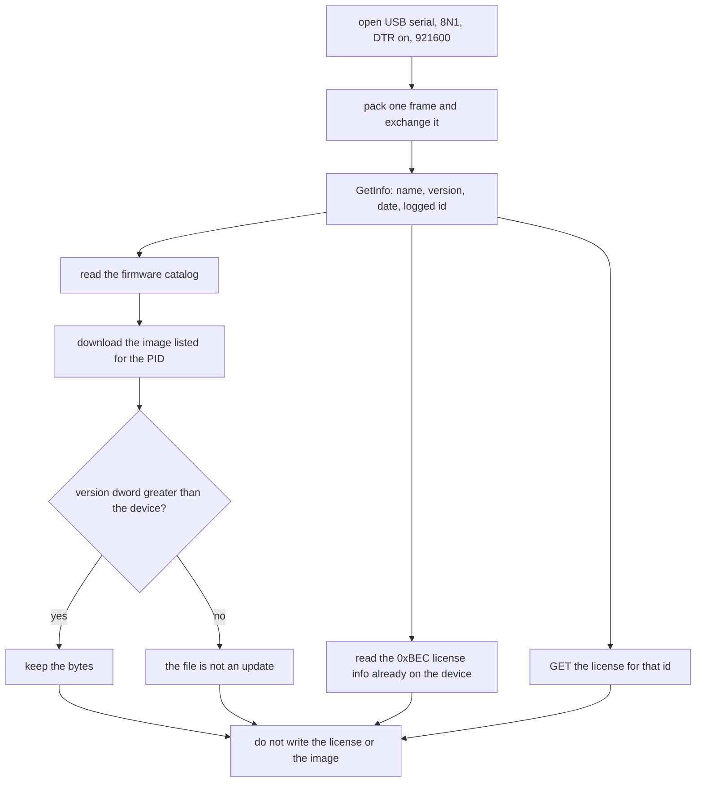

A retrieved license is the server body. It is not the `0xBEC` buffer ordinal 21
returns, and it is not written back. `newer_firmware` is stricter than the manager:
the manager arms an update when the catalog version string differs at all, and the
DLL still enters the boot mode when the device version dword is greater.

## The wire frame

`VCXCommSendFrame` (`0x7B2F9F20`) fills an internal buffer, then escapes it.

| Offset | Contents |
|---|---|
| 0 | `0x80` |
| 1 | `0x00` for the device commands, or a caller byte for `VCX_PRO_Send` |
| 2 | command |
| 3 | `0x00`, or the caller channel |
| 4 | payload length, a little-endian `u32`, refused above `0x1026` |
| 8 | checksum |
| 9 | payload |

The checksum starts at header byte 2. When byte 0 is `0x80` it adds `byte 3 - 0x80 + byte 1`.
Payload bytes are then added, two per step, and a leftover odd byte is added on its own.
For a header `80 00 cmd 00` that is `(cmd - 0x80 + sum of the payload) mod 256`. The empty
`GetInfo` request is `80 00 8C 00` and the checksum byte is `0x0C`.

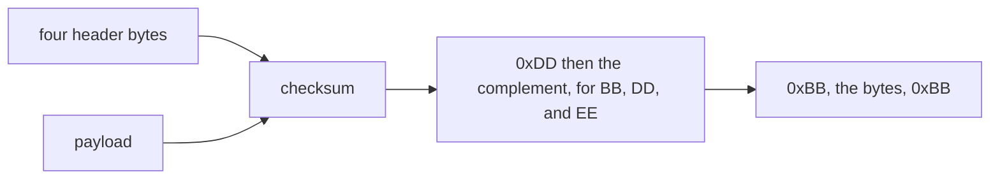

The escape reads the four header bytes, then the payload, then the checksum, and wraps
that stream in `0xBB`. A live `GetInfo` answer on 2026-11-20 matched this sum.

`VCX_SendFrame` (`0x7B2F54C0`) takes one caller buffer. Its length counts the
four header bytes and the payload, and a length above `0x1026` returns `0x94`.
A length of 0 returns `0x94`. A length of 1, 2, or 3 subtracts 4, the inner
check fails, and the export returns `0x82`. `VCX_RecvFrame` (`0x7B2F55E0`)
writes the header and the payload back, and stores that combined length.
`0x7B2F4860` splits a queued body into the header, the payload, and the last
byte. The stored payload length is the body length minus 5. The checksum byte
is kept and is not compared. An empty ring returns 0. `VCX_RecvFrame` tries
the ring at `device+0x24` and then the ring at `device+0x28`. A miss sleeps 1
millisecond. The deadline read after that sleep is virtualized. A missed
deadline returns `0x83`.

The device sender at `0x0801C17E` refuses a payload length of 0 or one past
`0x1026`. The checksum it stores at struct offset `0x102E` is the low 8 bits
of a byte sum. When header byte 0 is `0x80` the sum covers all four header
bytes and the payload, which is the same byte the crate's checksum
already returns. The wire frame is then the `0xBB` frame. When header byte 0
is not `0x80`, only header byte 2 and the payload are summed, and the wire
frame opens with `0xBB`, escapes `0xAA`, `0xBB`, and `0xEE` as `AA 0A`,
`AA 0B`, and `AA 0E`, and closes with `0xEE`.

`0x0801C294` reads one of those frames back. It picks the `0xDD` unstuffer
when a saved byte is `0x80`, and `0x0801BECA` otherwise. That unstuffer
requires at least 2 stuffed bytes. An `0xAA` takes the next byte as
`next | (next << 4)`. A plain result shorter than 2, or longer than `0x1002`,
is refused. Header byte 0 is stored as 0, header byte 2 is the first plain
byte, the last plain byte is the checksum, and the stored length is the plain
length minus 2. The destination bytes are drawn under [Device records](#device-records).

The same wait, at `0x7B2F4C90`, is what the command functions call after a send.
It compares queued header byte 2 with the command byte of the request. A match
returns 1. A queued `0x86` with a payload of at least 5 bytes stores the same
pin backup `GetPinVol` stores, and the wait continues. A `0x86` payload shorter
than 5 bytes stores nothing. Any other command is logged and the wait
continues. The timeout added is the dword at `device+0x20`. A miss returns 0,
and the caller returns `0x83`. `0x7B2F4B60` copies one ring chunk unchanged,
writes `0xBB` before it and after it, and stores the chunk length plus 2.

## License update, as the manager orders it

`DeviceInfoWnd::UpdateDeviceLicense` (`0x0042BA50`) opens with `VCX_Open` when byte
`device+0x1A91` is clear. A return of `0x7F` sets byte `+0x1A92`. `_ReadHWInfo`
(`0x00441F90`) then calls `VCX_DEV_GetInfo` into 64 bytes, `VCX_DEV_SynExInfo` into
128 bytes, `VCX_GetCommIf`, and ordinal 21 into `0xBEC` bytes at `device+0x128`.
A zero return from ordinal 21 sets byte `+0x1A94`. The logged id is taken from the
`GetInfo` serial only after byte 7 matches the xor of the other seven with `0x82`.

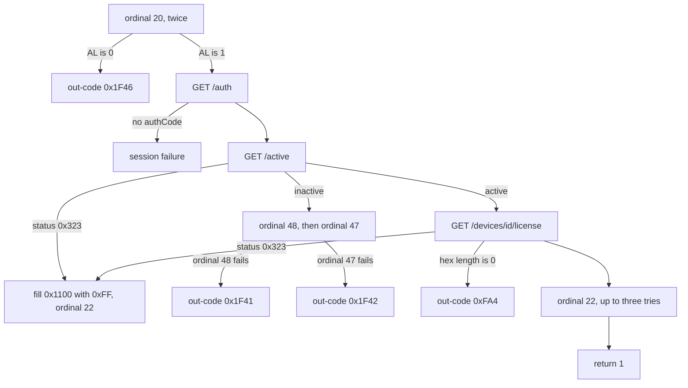

Ordinal 20 is `DAT_004B99B4`. `FUN_00442EA0` clears `0x44` bytes at `device+0xD14`
and stores a 16-byte `SYSTEMTIME` at `+0x00` and a 16-byte GUID at `+0x10`.
`FUN_00442FA0` is SHA-256 of those 32 bytes. The first call passes the block with
the dword at `+0x40` set to 0. On a zero return the manager compares eight dwords,
32 bytes at `device+0xD34`, with that digest. The immediate `0x1C` is the counter
the loop starts from. It steps down by 4 and stops once the counter is no longer
greater than 3, so the compare is 32 bytes. A match stores 1 at `+0x40`, writes the
digest back over those 32 bytes, and calls ordinal 20 again. The DLL export does not
show this sequence. Its body is the jump at `0x7B2F6A30`.

Ordinal 22 is `DAT_004B9928`, called with the handle and a `0x1100`-byte buffer.
The write loop in `UpdateLicense` (`0x00442280`) logs `try write license, time: {n}/3`
with the counter at 1, then 2, then 3. A zero return logs `write license okay`.
After the third failure the counter is 4, the branch at `0x00442D8B` joins
`0x00442DED`, the out-code is cleared, and the function returns 1. A failed write
is reported as success. This crate does not copy that loop.

Status `0x323` on the get-state path, the set-state path, or the download path calls
`EraseLicense` (`0x004421C0`). That fills `0x1100` bytes with `0xFF`, runs the same
ordinal-20 gate, and calls ordinal 22. This crate does not send that buffer.

Ordinals 20, 21, and 22 do not call `VCXCommSendFrame` by a direct call. Their
command bytes, chunk sizes, and per-frame layouts were not recovered. The log names
`VCX_DEV_ReqLicense`, `VCX_DEV_GetLicense`, and `VCX_DEV_SetLicense` have no xref.

## Firmware page records

`VCXHexLoad` (`0x7B2FAEC0`) reads `0x24` bytes, then one packed record per
`Head.PageNum`:

| Offset in the record | Contents |
|---|---|
| 0 | payload length, little-endian `u32` |
| 4 | a second dword, stored and not passed to `WrFlash` |
| 8 | `length` payload bytes |

The in-memory copy uses a stride of `0x410`. The allocation is `0x104024`, which is
the header plus 1024 slots. `PageNum` is the count that is actually walked.
`0x400` is only the capacity.

`read_pages` walks the packed records. A length above `0x1026` is refused. The
VCIA 1.9.4.2 catalog image is 191770 bytes, `Head.PageNum` is 187, and the packed
records consume the file exactly. Their lengths run from 8 to 1030. The second
dword is not the index `0..186`.

## Ordinal 0x27

`GetProcAddress` ordinal `0x27` is export 39 at `0x7B2F9C20`. It is not the named
`VCX_DFU_*` exports, and it is not Ghidra's `Ordinal_27` (that one is
`VCX_DEV_SetLed`). The export tail-calls `VCX_DFU_AutoUpdate` (`0x7B2F97B0`).
`UpdateVCIFirmware` calls it at `0x00435FC1` with the handle, the ANSI path of
`\VCX.bin`, 0, and a progress dword. The 0 does not survive: the function overwrites
that argument with the poll count 10. A zero return is the manager's "firmware has
upgrade" branch, which then calls `UpdateLicense`.

The manager decides to call it by a UTF-16 compare of the catalog `VERSION` with
the running version string (`0x00435566`). Any difference sets byte `window+0x504`.
An equal string skips ordinal `0x27`.

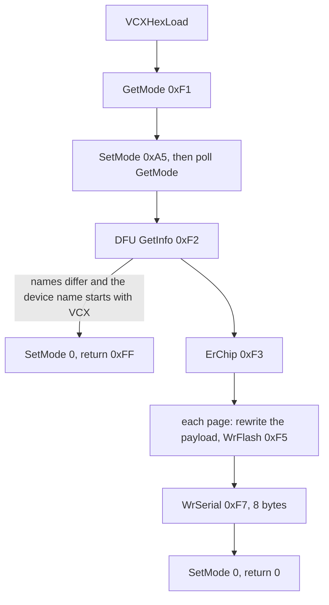

`GetMode` runs first. When its reply byte is already `0xA5`, the function jumps
to the DFU `GetInfo` call and skips the device `GetInfo`, the version compare,
and `SetMode 0xA5`. Otherwise it calls `VCX_DEV_GetInfo` (`0x7B2F8440`). The
device dword in the compare is at offset `0x34` of the buffer that call fills,
which is `DevInfo.FwVersion`. The file dword is at image+`0x0C` (`0x7B2F9905`).
When the device dword is greater it logs `Device FwVersion is New!` and falls
through. The log is not a refusal. `ErChip` and the page loop still run.
`Head.Key` at image+`0x10` is logged and is not an argument of any DFU command.

Each DFU command uses the internal buffer above, with channel `0x00`.

| Command | Byte | Payload |
|---|---|---|
| `SetMode` | `0xF0` | one byte, `0xA5` to enter and `0` to leave |
| `GetMode` | `0xF1` | empty. The reply length must be at least 2 |
| `GetInfo` | `0xF2` | empty. The reply length must be at least `0x21` |
| `ErChip` | `0xF3` | empty. Called once, before the page loop |
| `WrFlash` | `0xF5` | the buffer ordinal 37 is given. No page index is inserted |
| `WrSerial` | `0xF7` | 8 bytes, or the function returns `0x94` |

There is no sender for `0xF4` or `0xF6`. `VCX_DEV_Reset` is not called from this
function. Shared failure returns are `0x80` for a null device, `0x94` for a null
parameter, `0x82` for a send failure, and `0x83` for a receive failure. Success of
the whole update is `0`, at `0x7B2F9C08`. A refused name or a missed boot mode is
`0xFF`.

The 8-byte name check reads offset `0x20` of the buffer DFU `GetInfo` fills and
compares it with `Head.Name`. When the 8 bytes differ and the device bytes begin
`V`, `C`, `X`, the function calls `SetMode` 0 and returns `0xFF`.

Before each `WrFlash`, `0x7B2FAB90` rewrites the page payload at record+8. The
byte length is the record's first dword. The second dword is not an argument.
The key pointer is the DFU `GetInfo` buffer; the round uses its first 16 bytes,
not `Head.Key`. The instruction is `sub ebx, 0x61C88647`. Modulo `2^32` that
adds `0x9E3779B9`, and the mix is added into each little-endian word.
`rewrite_page` is that transform. It runs only when the caller supplies the key.
This crate does not ask the dongle for the buffer.

The `WrFlash` call that follows pushes the dword at the start of the loaded
image, not the page length. Every image `read_header` accepts begins
`A5 A5 A5 A5`, so that dword is `0xA5A5A5A5`. `VCXCommSendFrame` refuses a
payload above `0x1026`. `write_flash` builds the buffer ordinal 37 copies, with
no page index, and refuses a length above `0x1026`. It does not build the
`0xA5A5A5A5` call. `plan_firmware` records that length and `hold` refuses it.

`WrSerial` is called with length 8. At the resting frame, `[esp+0x20]` is the
third argument. The manager passes 0, so the other pointer is used:
`lea eax, [esp+0x3C]`. `GetInfo` filled the buffer at `[esp+0x28]`, and
`0x3C - 0x28` is `0x14`. The copy skips the reply's first payload byte, so
those 8 bytes are `payload[0x15..0x1D]`. `dfu_serial` reads them. A reply
shorter than `0x21` bytes is the same path as a failed receive: the log is
`VCX_ERR_COMM_RX` and the return is `0x83`, with no copy. `GetInfo` is
reached only after the boot poll has seen `0xA5`. Outside that mode the
device answers `80 00 F2 00` with the one byte `0x91`. A non-zero third
argument is the pointer instead of that buffer. The store of 10 is the
poll counter, at a different slot. After `WrSerial` returns, the zero-argument
path loads 10 into `ESI` and polls `GetMode` until the reply byte is 0. This
crate does not send `SetMode` and does not send `WrSerial`.

The boot-mode poll, after `SetMode 0xA5`, uses the same 10. The store is
`[esp+0x20] = 10` while the three log arguments are still pushed, and
`add esp, 0xC` makes that slot `[esp+0x14]`. Each pass calls `Sleep` and then
`GetMode`. The counter is decremented after the pass, and the pass repeats
while the value before the decrement was not 0, so the body runs 11 times
unless the reply byte is already `0xA5`. `poll_passes` is that count. The
leave poll has the same shape. `Sleep` is `[0x7B2FE0B4]`; its argument is
`0x1F4`. The dumped kernel32 base plus the `Sleep` export offset is
`0x751BD770`, the value in that slot.

`[0x7B2FE13C]` is `MessageBoxA`. The name refusal pushes a null owner, the text
`Device Firmware Wrong!`, the caption `Error`, and `0x1010`, then returns
`0xFF`. This crate does not show that dialog and does not send these commands.

The device image's records, the Ghidra names, and the calls that land inside
another routine are in [Device records](#device-records).

The DoIP row is a different worker (`0x004363D0`). It sends `\openwrt.bin` through
`ZWSFirmwareUpdate`, not through ordinal `0x27`. A Nano window leaves that byte clear,
so that pass does not transfer.

## Device records

These addresses are in `vcxa-1.9.4.2-plain.bin`, loaded at `0x08010000`.
The Ghidra program of that name has one address space, so the addresses below
are plain hex. Names were written with `rename_function_by_address`, and the
plate comments after the names. A prototype change on that server erases a
plate, so the prototypes were left as the decompiler had them. The program
was saved. Nothing in this section was sent to the dongle.

| Address | Ghidra name | Role |
|---|---|---|
| `0x0801BECA` | `ProcessPlusBody` | Undo an `0xAA` escape and fill the receive record |
| `0x08011CD8` | `CopyBytes` | Copy a byte count from the second argument to the first |
| `0x08019466` | `HandleQueueRecord` | Pick one of ten slots and decide whether to update it |
| `0x0802DD94` | `SetKind3Record` | Store three fields, then set the kind byte to 3 |
| `0x080188B0` | `ProcessQueuedCan` | Read the record at object `0xC68` and fill the header |
| `0x08018A6A` | `ProcessQueuedCan` | Kind test inside that function |
| `0x08018A8E` | `ProcessQueuedCan` | Id shuffle inside that function |
| `0x08019140` | none | Record logger. The push is here, and Ghidra has no function |
| `0x08011DE8` | none | XXTEA-shaped mix. Left unnamed, for the reason below |

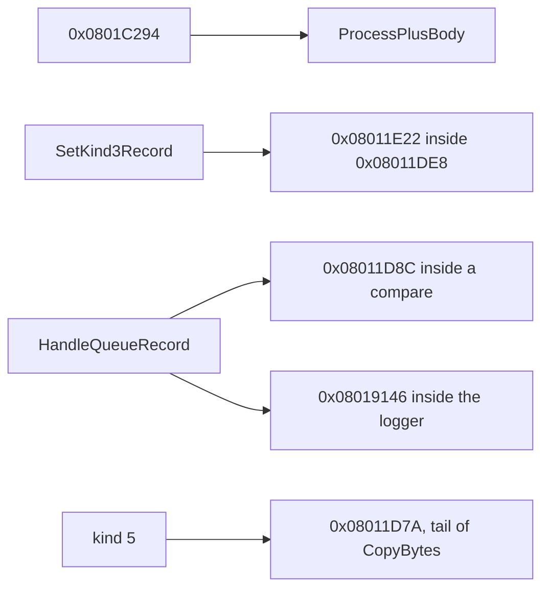

### A non-0x80 body

`0x0801C294` uses `ProcessPlusBody` when the saved header byte is not `0x80`.
The stuffed interior is the bytes between `0xBB` and `0xEE`. An `0xAA` consumes
the next byte and stores `next | (next << 4)`.

| Stuffed pair | Plain byte |
|---|---|
| `AA 0A` | `0xAA` |
| `AA 0B` | `0xBB` |
| `AA 0E` | `0xEE` |

A stuffed interior shorter than 2 bytes is refused before that walk. A plain
result shorter than 2, or longer than `0x1002`, is refused. The walk below is
the one that finishes.

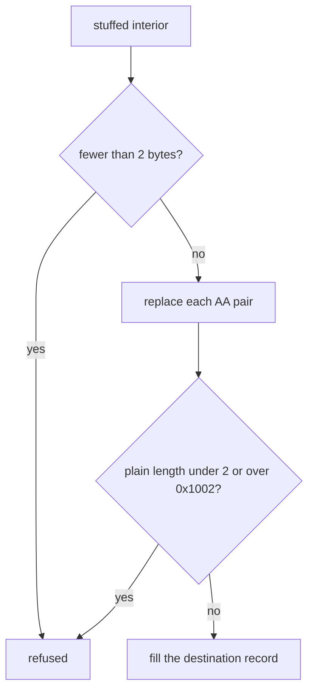

The destination is `r4`. The stuffed source is `r5`. The decompiler leaves both
as undeclared registers, which matches a body that keeps them live across the
calls. The stores themselves are the same in the decompiler and in the
disassembly the crate follows.

| Destination offset | Width | Value |
|---|---|---|
| 0 | byte | 0 |
| 2 | byte | first plain byte, the command |
| 4 | dword | plain length minus 2 |
| 8 | bytes | plain bytes between the command and the checksum |
| `0x102E` | byte | last plain byte, the checksum |

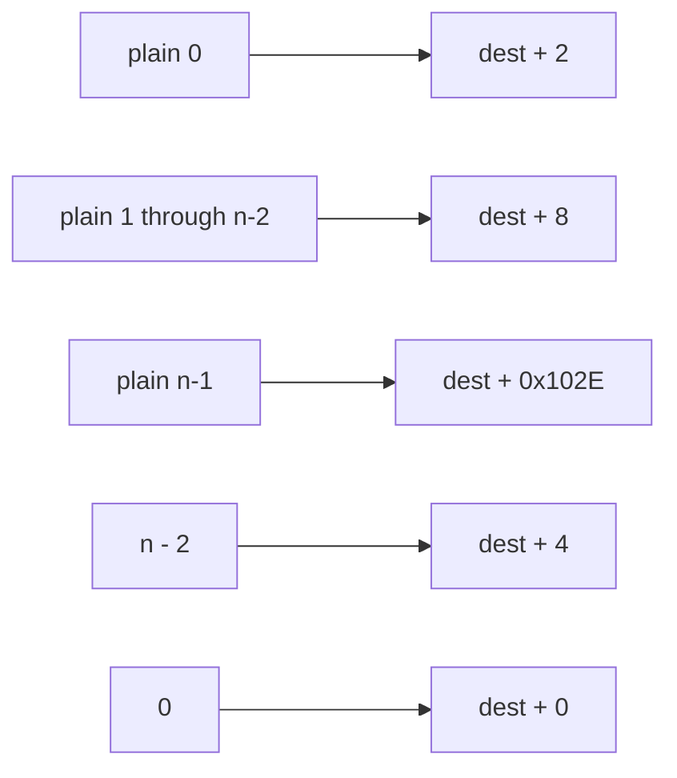

`plus_body` returns the command, the middle bytes, and the checksum. It refuses
the same two lengths.

### Kind 3

`SetKind3Record` takes the destination in the second argument and the source in
the third. It logs the dword already sitting at destination offset `0x10`. It
does not write that slot.

| Source | Destination |
|---|---|
| dword at 0 | dword at `0x18` |
| byte at `0x0C` | halfword at 2 |
| | byte at 0, written last, value 3 |

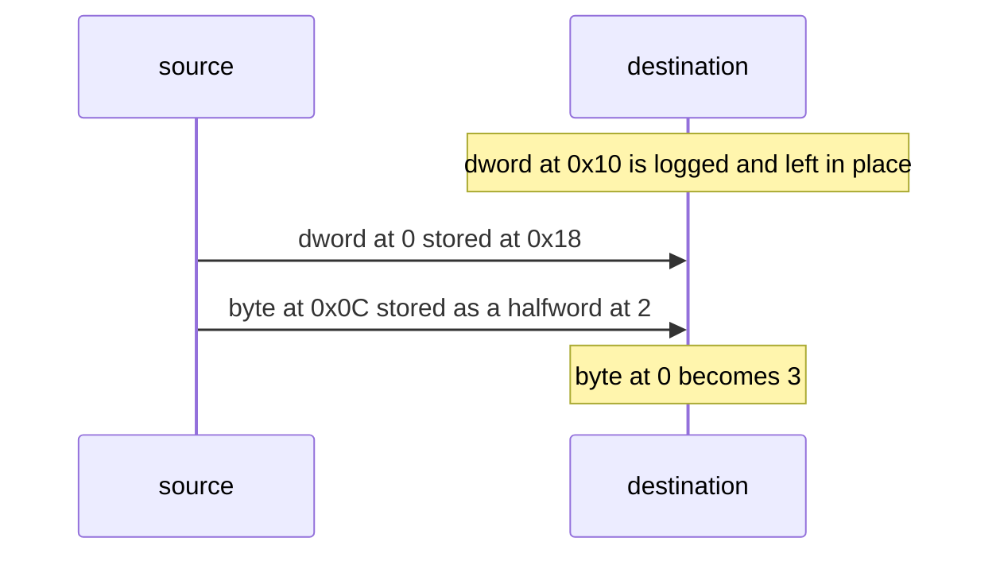

The call after those stores is `bl 0x08011E22`, with the pointer at destination
`0x1C`, the source address plus 4, and the same source byte. `0x08011E22` is
`lsls.w r8, r7, #4` inside `0x08011DE8`. Ghidra also created a function at that
interior address, so a decompile of the caller shows a call, and a decompile of
the interior starts in the middle of the mix. The bytes at source offset 4 are
not written by that call. `stage_record` keeps the three stores and leaves the
call out.

`0x08011DE8` divides the length by 4, adds 6 to `0x34` divided by that count,
and subtracts the XXTEA mix `(z >> 5 ^ y << 2) + (y >> 3 ^ z << 4)` combined
with the sum and a key word. The image holds `0x9E3779B9` at `0x08012704` and
`0x61C88647` at `0x08012708`. The load at `0x08011E06` reads `0xF7FFA80B` from
`0x080126F8`, twelve bytes before the usual delta. That is why the routine has
no Ghidra name.

### Ten queue slots

`HandleQueueRecord` takes the queue object in `r0` and the record in `r1`.

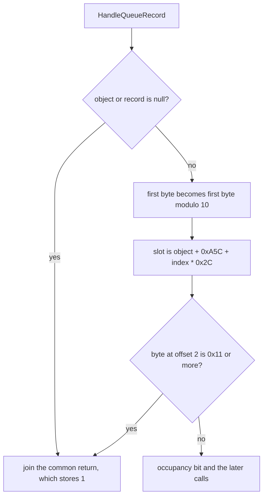

A null object or a null record is the compare at `0x08019472`. Either one
branches to `0x0801947A`, which logs, stores 0, and jumps to `0x08019536`.
That address logs again and stores 1 before the pop. The `0x11` check at
`0x080194A6` takes the same jump. The index store at `0x08019494` has already
run by then.

The occupancy dword is at object offset `0xA50`. Slot 0 starts `0x0C` bytes
later, at `0xA5C`. Each slot is `0x2C` bytes, and the index is modulo 10, so
the object holds ten slots. Slot 1 is `0xA88`. Slot 9 is `0xBE8`.

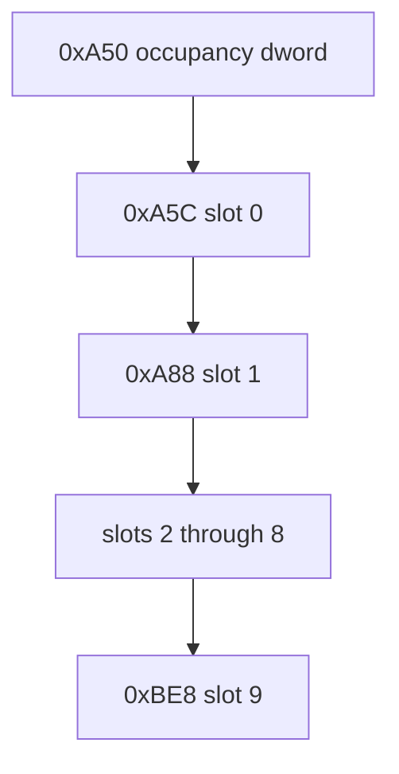

On the update path the word at `0xA50` is combined with `1 << index`. The
branch taken when byte 2 is 0, or when the dword at offset 4 is 0, enters that
bit update in the middle of its instructions (`0x080194B2` and `0x080194B8`
both branch to `0x080194F6`). The stores on that branch stay undescribed,
because the branch enters the bit update in the middle of its instructions.
The call at `0x08019526` enters a compare at `0x08011D8C` with length
`0x2C`. It is not `CopyBytes`. `place_queue` keeps the index, the slot offset,
and the `0x11` decision.

The logger's push is `0x08019140`: `push {r3, r4, r5, lr}` and `mov r4, r0`.
`HandleQueueRecord` calls `0x08019146`, which is the first `bl` inside that
push. Ghidra has a function there and none at the push, and the decompile uses
an undeclared register as the record pointer. The bytes it prints, when the
pointer is the record, are the bytes at offsets 0, 1, 2, and 3, the dwords at
4 and `0x28`, then `byte 2` bytes from offset 8 and `byte 3` bytes from offset
`0x18`.

### Queued CAN

`ProcessQueuedCan` starts at `0x080188B0`. Ghidra had no function there until
this entry was created. The record is the object plus `0xC68`, so the kind
byte at record offset 0 is the byte at object offset `0xC68`. The second
argument is the header.

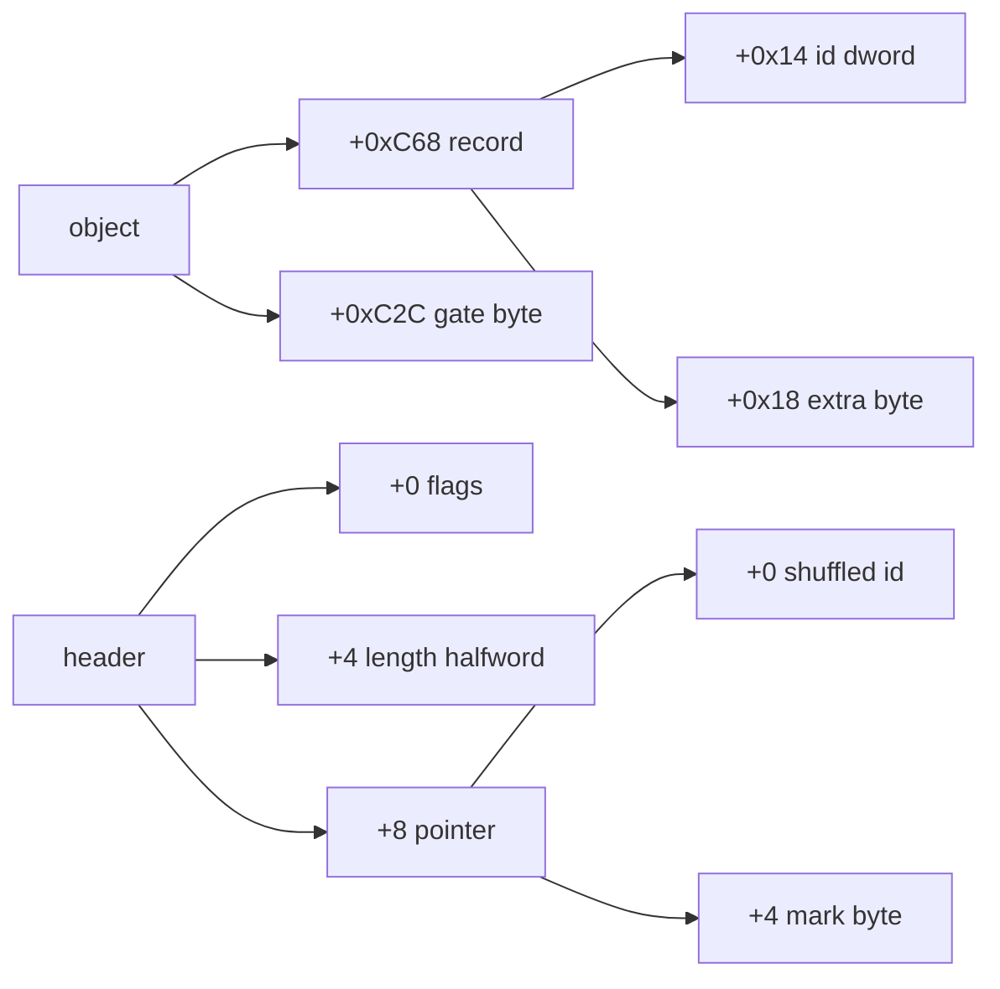

Before the kind test, the low byte of the dword at object `0xC50` is stored at
record + 1, the low byte of the dword at object `0xC54` is stored at record + 2,
and the dword at object `0xC3C` is stored at record + `0x10`.

`0x08018A6A` is the kind test inside that function. The kind byte is at record
offset 0.

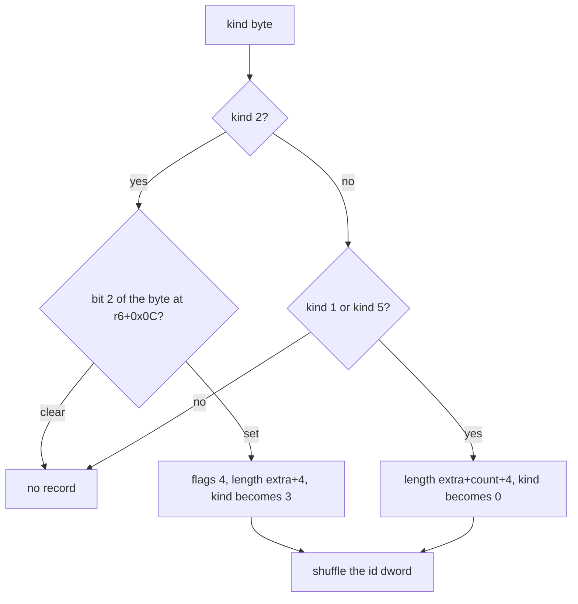

Kind 5 reaches `0x08011D7A` through `0x08018B36`. `CopyBytes` returns from
`0x08011D7C` when the carry flag is clear, and the `movs` just before that
call leaves it clear. No byte is stored.

`0x08018A8E` rewrites the id dword.

| Source bits | Stored bits |
|---|---|
| 24..28 | 0..4 |
| 16..23 | 8..15 |
| 8..15 | 16..23 |
| 0..7 | 24..31 |

Bits 29..31 of the source are left out of the stored id. Bit 31 on its own
sets flag `0x100`. A non-zero extra byte sets flag `0x400` and keeps the
following byte. The stored length is the low 16 bits of the length above.

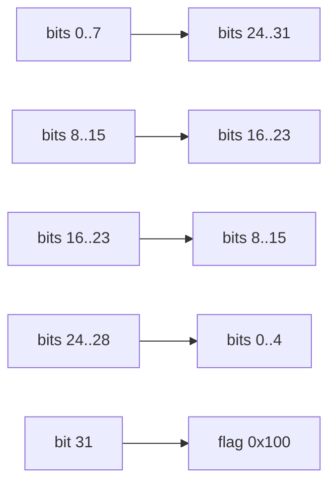

### Looks that stayed unlabeled

The string `bsp_can_filter_set: port=%d, channel=%d, id=%08x, mask=%08x` has
one pointer, the suffix at `0x0801E6B0`, loaded at `0x08018DB2`. The two record
loads just before that instruction are a halfword at offset 0 and a dword at
offset 4. The switch that owns the function jumps to the call at `0x08018DB4`,
past those loads. There is no four-field filter record on that path.

The format `flow = %02x, txid = %08x` is passed as a buffer pointer from
`0x0801C1B8`, `0x0801C1D4`, `0x0801C2BC`, and `0x0801C2D0`. None of those sites
loads a flow byte and a txid dword out of one record to print them.
