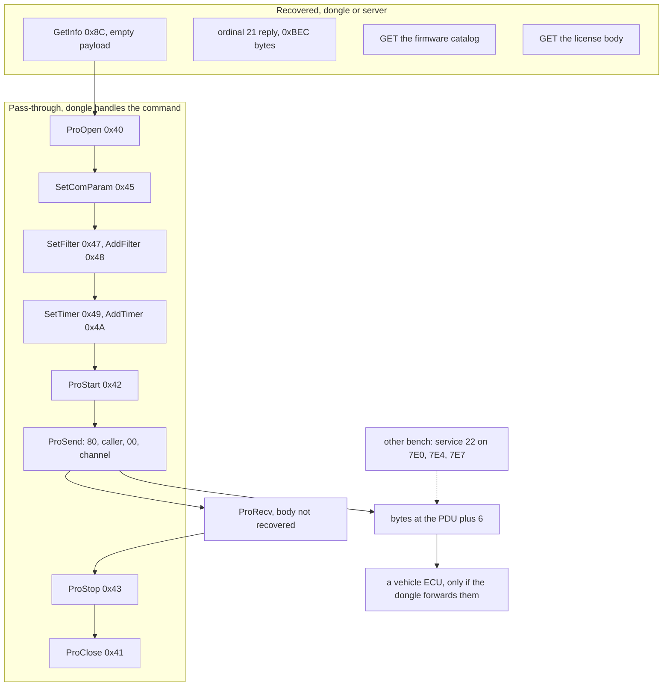
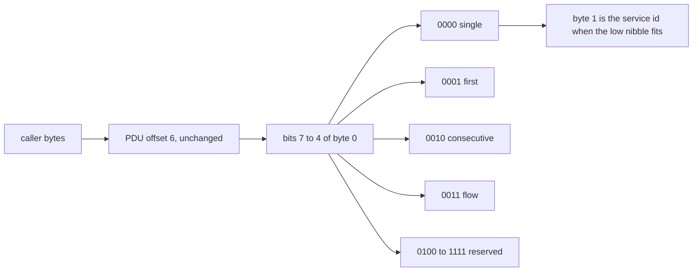
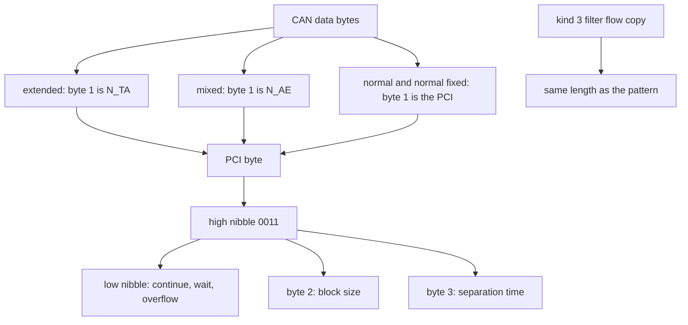
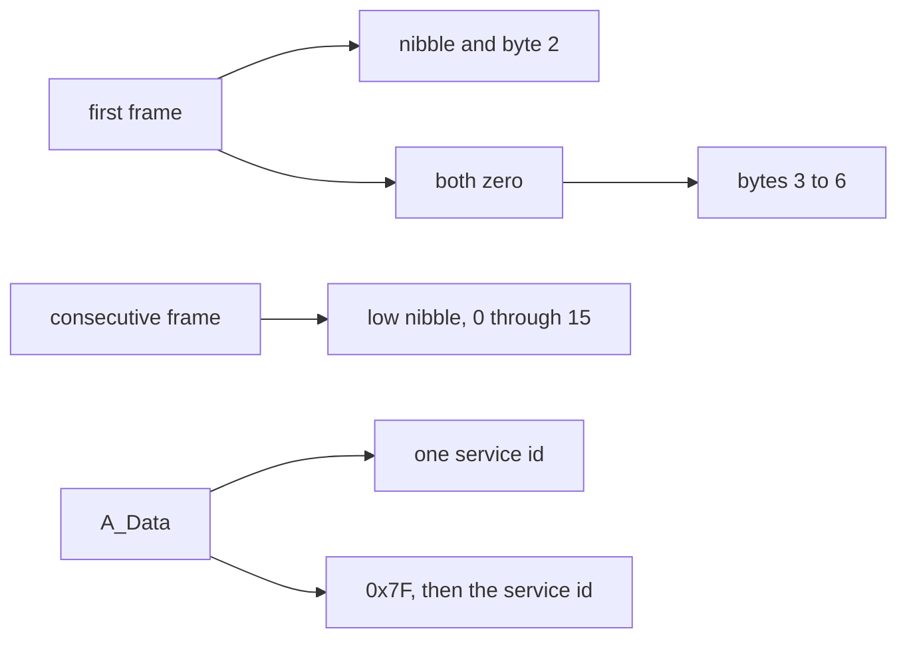

# Reads

What has to be read before a brake-module identity can be named, and which of those
reads this crate already performs. No step here was sent for this note. COM4 was
not opened. No erase, no security seed, and no vehicle write.

SAE J2534 is not imported. ISO 14229-1:2013, ISO 15765-2:2016, and ISO 15031-3:2004
are present in `primarysource`. They were not the source of the pass-through
layouts below. The PCI names in
[The copy and the two standards](#the-copy-and-the-two-standards) come from the
first two of those standards. The pass-through still does not build those bytes.
The layouts were read from `vcx-reconstructed.dll` (image base `0x7B2F0000`) and
from `ManagerCenter.exe` (image base `0x400000`). A byte that those two programs
do not contain is marked theory, and it is not a frame.

The solid boxes are recovered command layouts. The dashed edge is the other bench.
`ManagerCenter.exe` loads every `VCX_PRO_*` name in `FUN_00427380` and the
cross-references of those stored pointers are writes. The manager does not call
them. The brake-module identity row in [ROADMAP.md](../ROADMAP.md) is still open.

## Device reads

These are already implemented. None of them is a vehicle module.

| Read | Bytes | Who answers | Where it was recovered |
|---|---|---|---|
| `GetInfo` `0x8C` | Empty payload. Header `80 00 8C 00`. | The dongle. The logged fields are in [sources.md](sources.md). | `VCX_DEV_GetInfo`, and a live reply on 2026-11-20. |
| On-device license | Ordinal 21 sends `GetInfo`, then header `80 00 A0 00` with eight payload bytes, then header `80 00 83 00` with an empty payload. The `0xA0` reply is status `0x00`, eight bytes, and a checksum. The `0x83` reply is one byte plus `0xBFC` ciphertext bytes. The key is the raw serial plus `reply^secret` modulo `2^64 - 59`, where the eight request bytes are `5^secret` in that modulus. | The dongle. | `license_nonce`, `license_key_half`, and `decrypt_license`. `read_license` sends the three frames. |
| Firmware catalog | `GET https://www.vxdiag.net/managecenter/fws.xml`. Not a serial frame. | The server. | `FirmwareURL` in the manager. Implemented. |
| Server license | `GET {LicenseServerURL}/devices/{id}/license`. The body field `result.license` is hex. On 2026-11-20 that hex was 4076 bytes. | The server. | The manager. Implemented. Not written back. |

Ordinals 20 and 22 are not reads. Their command bytes were not recovered, so this
crate does not build a license write or the `0x1100`-byte `0xFF` erase. That gap
is the license section of [protocol.md](protocol.md).

## Pass-through commands

Header byte 0 is `0x80`. Byte 1 is `0x00` except for `VCX_PRO_Send`. Byte 2 is the
command. Byte 3 is the caller's channel. The DLL does not name the channel or the
integers it copies. The names in the table are the export names. The dongle is the
module that receives the command. A vehicle ECU is not the module that receives
`ProOpen`, `SetComParam`, a filter, a timer, `ProStart`, `ProStop`, or `ProClose`.

| Export | Address | Payload, recovered from the function |
|---|---|---|
| `VCX_PRO_Open` | `0x7B2F5A60` | 4 bytes. The third argument, stored big-endian. |
| `VCX_PRO_Close` | `0x7B2F5BA0` | Empty. |
| `VCX_PRO_Start` | `0x7B2F5CD0` | 1 byte, the third argument. |
| `VCX_PRO_Stop` | `0x7B2F5E10` | Empty. |
| `VCX_PRO_SetComParam` | `0x7B2F5F40` | See below. |
| `VCX_PRO_SetFilter` | `0x7B2F6140` | 1 byte, the third argument. |
| `VCX_PRO_AddFilter` | `0x7B2F6280` | See below. |
| `VCX_PRO_SetTimer` | `0x7B2F6480` | 1 byte, the third argument. |
| `VCX_PRO_AddTimer` | `0x7B2F65C0` | See below. |
| `VCX_PRO_Send` | `0x7B2F5740` | Header `80`, a caller byte, `00`, the channel. Payload below. |
| `VCX_PRO_Recv` | `0x7B2F58E0` | Not recovered. The body is the two calls `FUN_7b585b66` and `FUN_7b44679c`. |
| `VCX_PRO_GetComParam` | `0x7B2F60F0` | No frame. A null device returns `0x80`. Otherwise the function returns 0. |
| `VCX_PRO_Clear` | `0x7B2F67A0` | No frame. It clears dwords in the block at `device+0x24`. |

`set_com_param`, `add_filter`, and `add_timer` build these payloads and do not send them.
`close_payload` and `stop_payload` are empty. `start_payload` is the single byte `0`.
`set_filter_payload` and `set_timer_payload` are the single byte `1` or `2`. Any other
byte is refused. `VCX_PRO_Recv` still has no body.

`SetComParam` reads a count from argument byte 0. The payload length is `count * 6`.
Each record is 8 bytes, starting at argument offset 4. On the wire each record is
6 bytes: the `u16` at record+0 stored big-endian, then the `u32` at record+4
byte-reversed. Record bytes 2 and 3 are not copied.

`AddFilter` reads a count from argument byte 0. Argument bytes 1, 2, and 3 are
not copied. Records start at offset 4 and are `0x34` bytes apart. Each record
contributes four bytes, at record+0, record+4, record+8, and record+12. The dword
at record+4 selects trailing copies, each of `record+12` bytes: one copy from
record+`0x0D` when the dword is at least 0, another from record+`0x19` when it is
at least 1, and another from record+`0x25` when it is at least 2.

`AddTimer` reads the count from the dword at offset 0. The first payload byte is
the low byte of that dword, and the loop runs for the whole dword. Records start
at offset 4 and are `0x28` bytes apart. Each record contributes its first four
bytes and then the dword at record+4, copied as a little-endian dword. When
record byte 2 is nonzero, that many bytes are copied from record+8. When record
byte 3 is nonzero, that many bytes are copied from record+`0x18`.

`VCX_PRO_Send` does not call the receive function. It sets `device+0x1C` to 1;
the other `VCX_PRO_*` senders set that dword to 0. The PDU argument is a `u32` at
offset 0, a `u16` length at offset 4, and that many bytes at offset 6. The length
must be at most `0x1020`. The payload is the `u32` byte-reversed, the `u16`
stored big-endian, and then those bytes. The bytes at offset 6 are the only bytes
in this set that could be forwarded past the dongle. No brake-module request was
found in either program. Search of both programs for `brake`, `ABS`, `EBCM`, and
`7E0` found no vehicle frame. The `identity` hit in `ManagerCenter.exe` is the
Windows manifest's `assemblyIdentity`.

`VCX_PRO_Recv` would be the read of whatever the dongle returned after a send.
Its layout was not recovered. A brake-module identity reply cannot be parsed
until that body is.

## The open row

The brake-module identity read, with no security seed and no write, is this
sequence and nothing past it:

1. The device reads above, so the dongle on the port is the one already identified.
   Those reads do not address a brake module.
2. `ProOpen`, `SetComParam`, the filter commands, the timer commands, and
   `ProStart`, with the layouts above. The integers those functions copy are not
   in either program, so a concrete channel open is not yet a frame.
3. `VCX_PRO_Send` of a PDU whose prefix is recovered and whose bytes at offset 6
   are not in the VXDIAG binaries. Those bytes are the ones a vehicle ECU would
   see, and only if the dongle forwards them. The GM SPS application layer
   (`spsvcs.dll`, the dated subsection above) does recover the identity request's
   content — service `$1A`, DID `0xB0` (DiagnosticAddress), single frame
   `02 1A B0` — but not the `C1`..`CC` part-number sweep nor the concrete request
   CAN id, so the full read is still not a frame.
4. `VCX_PRO_Recv` for the reply. The export is virtualized. The copy out of
   its PDU is recovered and is below.
5. `ProStop` and `ProClose`, empty payloads, the dongle.

Step 3 is the open row. It stays open because the inner bytes are not recovered.
Inventing them would be a frame this note does not have.

The *transport* of this sequence — open the channel, write a caller-supplied framed
request, read the reply — is `src/device.rs` (`Channel`), built on the same
`SerialPort` seam `doctor`/`GetInfo` uses and exercised end to end by an in-process
fake serial. It wraps no `$1A` content (the caller passes the bytes
`collect::frame_identity_request` builds) and transmits nothing on its own: the only
real-hardware path is an `#[ignore]`d test that opens the channel against the dongle
and sends no request, and the live vehicle send stays held behind `vehicle_read_gate`.

### What a 2026-11-22 static pass settled, and what it did not

The frame *envelope* for both directions is recovered. The vehicle-facing request
*content* is not in the VXDIAG transport binaries; a later pass found it one layer
up, in the GM SPS application (the dated subsection below), but a *full* identity
read is still not a recovered frame, so the open row stays open and
`READ_LAYOUT_RECOVERED` stays `false`. Each claim below is anchored to a function,
confirmed in the Ghidra project (VCX.dll is `vcx-reconstructed.dll`, base
`0x7B2F0000`).

- **Send framing, recovered.** `VCX_PRO_Send` (`0x7B2F5740`) builds header
  `80`/caller/`00`/channel, stores the PDU flag dword byte-reversed, the length
  as a big-endian `u16`, and copies the offset-6 bytes through the thunk
  `FUN_7b2fd9a4` → `thunk_FUN_7b6a0987` (a `memcpy`). The `0x1020` cap is in the
  function. This is `forward::send_payload`, and `collect::frame_identity_request`
  wraps a caller's bytes in it. The offset-6 bytes stay the only vehicle-facing bytes.
- **Reply read layout, recovered — from the host, not the export.** The
  virtualized `VCX_PRO_Recv` only fills the PDU; its shape is read by
  `VCXPT32!ConvertVCXMsg` (`FUN_10006070`, base `0x10000000`), which is not
  virtualized: a little-endian `u32` flag word at offset 0, a little-endian `u16`
  length at offset 4, and that many data bytes at offset 6. For ISO 15765 (case
  `6`/`0x10000`) every data byte is kept; it only rewrites protocol `6`→`5` when
  flag bit 0 is set. The flag map and the per-protocol trailing drops are already
  `forward::rx_status`, `delivered_len`, and `reply_protocol`;
  `collect::reply_application_bytes` and `read_identity_reply` apply that envelope.
- **Request content, absent from the VXDIAG transport.** No `$1A` request builder
  is in `VCX.dll`, `ManagerCenter.exe`, or `VCXPT32.dll`. A byte-pattern search for
  the default DID run `C1`..`CC` in `vcx-reconstructed.dll` matched only a
  coincidental monotonic ramp (`b8 b9 … d7` at `0x7b3329a0`), not a request table.
  `ConvertPassthruMsg` (`FUN_10005df0`) copies the caller's ISO 15765
  `PASSTHRU_MSG.Data` to offset 6 unchanged — it forms no request of its own. The
  service id, the identifiers, and the module CAN id are GM application-layer, built
  by the diagnostic software one layer up, not by this transport. That application
  layer was then read, below; the mapping onto these offset-6 bytes is at the
  application-PDU seam, and `docs/tool-boundary.md` keeps the content out of this
  crate.
- **Recv export internals, blocked.** `VCX_PRO_Recv` (`0x7B2F58E0`) is a `jmp`
  into section `.V0`; its callees `FUN_7b585b66` / `FUN_7b44679c` decompile to
  garbage that reads uninitialized `EAX`/`EBP`/`CF` (VMProtect). Not statically
  recoverable, and not needed: the PDU it writes is laid out by `ConvertVCXMsg` above.

### The `$1A` request content, from the GM SPS application (2026-11-22)

The VXDIAG transport binaries carry no `$1A` builder (above) because the request is
formed one layer up, in GM's SPS application. A static pass over `spsvcs.dll` (image
base `0x10000000`, the `CVIT1` class) recovered it. These are application-layer
anchors, not VXDIAG transport: they say what bytes a `$1A` identity read *is*, which
the VXDIAG copy carries at a Send PDU's offset 6. Nothing here was sent, and the two
remaining gaps below keep `READ_LAYOUT_RECOVERED` `false`.

- **The identity read is service `$1A`, DID `0xB0` (DiagnosticAddress).**
  `CVIT1` base-mapping read `FUN_10012a80` (`0x10012a80`); its debug string
  `"ReadDataByIdentifier (0x1A) service with DID 0xB0 (DiagnosticAddress)"` is at
  `0x100e6a78` (logged from `0x10012b96`). It builds a 12-byte request at
  `*(this+4)` with these exact stores: `0x10012ba6` `buf[0]` = flags (`this+0x14`);
  `0x10012bb0`–`0x10012be6` `buf[1..4]` = the target diagnostic address
  (`this+0x224`) as a **big-endian** `u32`; `0x10012be9`–`0x10012c01` `buf[5..8]` =
  `00 00 00 00`; `0x10012c08` `buf[9]` = `0xFE`; `0x10012c0f` `buf[10]` = `0x1A`
  (service); `0x10012c16` `buf[11]` = `0xB0` (DID). It sends through the transport
  object `this+0x11c`, `vtbl+0xC`, length `0xC`, at `0x10012c27`; success is `0x100`.
- **Positive reply layout, consistent with the recovered Recv envelope.** The read
  (`vtbl+0x10`, `0x10012c60`) requires reply length ≥ `0xC` (`0x10012c8c`),
  `reply[0x0A] == 0x5A` (`0x10012c9c`), and `reply[0x0B] == 0xB0` (`0x10012ca6`) —
  positive SID `0x5A` echoing DID `0xB0`, which is `collect::IDENTITY_POSITIVE_SID`
  and the `$1A` echo rule already in the reply parser. The responder id is the
  big-endian `u32` at `reply[5..8]` (`0x10012d10`), classified by CAN-id range
  `0x641`..`0x65F` (`0x10012d40`) and, when `reply[0] == 0x04`, `0x7E8`..`0x7EF`
  (`0x10012eef`) — the GMLAN and ISO 15765 physical response ids. Response-offset
  flags are `id | 0x200` and `id | 0x500`.
- **The framing generalizes across the GMLAN session services.** The 10-byte header
  `[flags][addr BE u32][00 00 00 00][0xFE]` is built by the helper `FUN_10014580`
  (`0x10014580`) and reused for ReturnToNormalMode `$20` (`FUN_10013340`,
  `buf[10]=0x20`, length `0xB`), InitiateDiagnosticOperation `$10 02` disableAllDTCs
  (`FUN_10013520`, `buf[10..11]=10 02`, length `0xC`), DisableNormalCommunication
  `$28` (`buf[10]=0x28`, length `0xB`), and ReportProgrammedState `$A2`
  (`buf[10]=0xA2`, length `0xB`). In every case the **application `A_Data` begins at
  PDU offset 10** — request `[SID][sub…]`, reply `[SID|0x40][sub…]`. The leading 10
  bytes are the SPS CAN-interface transport envelope (the object `this+0x11c`, the GM
  CAN link opened in `FUN_100198a0`), not vehicle bytes.
- **What maps onto the wire.** `spsvcs.dll` drives its own GM CAN interface, a
  different stack from VXDIAG, so the mapping is at the application-PDU seam, not a
  byte-identical transport. The GMLAN application bytes are `1A <DID>`; on ISO 15765
  that is a single frame `02 1A <DID>` (PCI length `0x02`, then the two service
  bytes). `ConvertPassthruMsg` (`FUN_10005df0`) copies the caller's ISO 15765
  `PASSTHRU_MSG.Data` to Send PDU offset 6 **verbatim**, and the dongle adds the
  ISO-TP single-frame PCI (see "What the pass-through copies"). So offset 6 carries
  the CAN arbitration id and `1A <DID>`; the SPS `[flags][addr][0000][FE]` header
  does **not** ride on the vehicle wire — the transport layer translates the addr
  `u32` into the CAN request id.
- **What is still not recovered.** Two pieces, so the open row stays open:
  1. **The `C1`..`CC` part-number DID sweep.** `spsvcs.dll`'s `CVIT1` issues `$1A`
     for DID `0xB0` only — a byte search for a `buf[10]=0x1A` store (`c6 ?? 0a 1a`)
     matches a single site, `0x10012c0f`, and `ivcsSgm.dll` has no
     `ReadDataByIdentifier` string or `$1A` builder at all. The `C1`..`CC` set in
     `collect::DEFAULT_IDENTITY_LIDS` is the GMLAN part-number DID convention, not a
     binary-anchored sweep.
  2. **The concrete request CAN id.** The target address (`this+0x224`) is runtime
     state, not an immediate in the binary; the base read uses a functional target
     set at run time, with the per-responder physical ids coming back in
     `reply[5..8]`.

## What the pass-through copies

`VCXPT32.dll` is the caller `ManagerCenter.exe` is not. `PassThruWriteMsgs`
(`0x100039e0`) does not contain a module request. `FUN_10005df0` refuses a data
length above `0x1020`, writes the flags dword and that length, and copies the
caller's bytes to PDU offset 6. `VCX_PRO_Send` (`0x7B2F5740`) stores the dword
big-endian, the length big-endian, and then those bytes. `send_payload` builds
that payload. It does not transmit it.

`PassThruConnect` (`0x100035e0`) calls `VCX_PRO_Open` with the dword
`FUN_10005a20` returns, then `VCX_PRO_SetComParam`, `VCX_PRO_SetFilter` with
third argument 1, and `VCX_PRO_Start` with third argument 0. The logged names
and the dwords are:

| Caller protocol | Log name | `VCX_PRO_Open` dword |
|---|---|---|
| 1, `0x8000` | `VCX_PROTOCOL_J1850_VPW` | `0x8505` |
| 2, `0x8001` | `VCX_PROTOCOL_J1850_PWM` | `0x8606` |
| 3, `0x8002` | `VCX_PROTOCOL_ISO9141_UART` | `0x9104` |
| 4, `0x8003` | `VCX_PROTOCOL_ISO14230_UART` | `0x9004` |
| 5, `0x8004`, `0x8008`, `0x800f` | `VCX_PROTOCOL_ISO11898_CAN` | `0x8101` |
| 6, `0x8005`, `0x8007`, `0x8010`, `0x10000` | `VCX_PROTOCOL_ISO15765_CAN` | `0x8001` |
| 7, 8, 9, 10 | `VCX_PROTOCOL_J2610_SCI` | `0x8a0a` |
| `0x800a`, `0x10004` | `VCX_PROTOCOL_KW1281_UART` | `0x9204` |
| `0x800b`, `0x10003` | `VCX_PROTOCOL_DIAGH_UART` | `0x9104` |
| `0x800e` | `VCX_PROTOCOL_TP20_CAN` | `0x8401` |
| `0x80000001`, `0x80000002` | `VCX_PROTOCOL_LIN_UART` | `0x9d04` |

For ISO 15765 the copied bytes are unchanged, and the flags dword receives bits
from the caller's flag word. For J1850, `FUN_10005ce0` appends one inverted
check byte. For the UART protocols, when flag `0x200` is clear, `FUN_10005c10`
appends the sum of the data bytes. A brake-module identity would be those copied
bytes. This DLL does not contain them. The dongle is still the module that
receives `VCX_PRO_Send`. An ECU sees the copy only if the dongle forwards offset 6.

When the message protocol differs from the channel protocol, `FUN_10005df0`
sets PDU bit 0 and logs `CAN_MIXED_FORMAT` only if channel `+0xa4` is set, the
channel id is one of the ISO 15765 ids, and the message id is one of the raw
CAN ids. Every other mismatch returns `0x15` and does not finish the copy.
`mixed_bit` is that bit.

Connect's `SetComParam` buffer is one record: count `1`, key `3`, value the
caller's baud. `baud_record` is that record. `SetFilter`'s third argument is
`1` on connect and `2` for `CLEAR_MSG_FILTERS`. `Start`'s third argument is
`0`, and protocols `0x8000` through `0x8011` and `0x80000002` skip that call.
`AddFilter` copies the caller's pattern, mask, and flow-control bytes. When
the mask flag `0x100` is set, pattern byte 0 is ORed with `0x80`. No constant
module id is in those buffers.

`SET_CONFIG` (`FUN_10005840`) replaces that one record with the list
`config_records` builds. ISO 9141 multiplies the connect defaults by 500,
1000, or 2000. ISO 15765 ends with key `0x23`, value `4`, and adds key
`0x8001`, value `2`, when channel `+0x154` is not 0. A pin word of `0x060E`
forces key `0x100` to 0. Protocol `0x800E` stores key `0x100` as 0 when the pin word is `0x060E`.
Any other pin word leaves that dword unchanged, so the record is not built.
A later `0x8405` record sits outside the count the packer sends. LIN has no
builder, so the buffer already stored is sent again. The connect default at
`+0xa8` is a zero dword, which clears `+0xa9` too.

## What a read copies back

`VCX_PRO_Recv` at `0x7B2F58E0` is `jmp 0x7B73BB48`, and that address is in
section `.V0`. The body was not recovered.
`VCXPT32` calls it from the event callback `FUN_10006a40` when the callback's
second argument is `1`. The PDU it returns is parsed by `FUN_10006070`: a
little-endian flags dword at offset 0, a little-endian `u16` length at offset 4,
and that many bytes at offset 6. `PassThruReadMsgs` then copies one queued
record. It does not call `VCX_PRO_Recv` itself.

`rx_status` is the flag map. `delivered_len` is the trailing-byte drop:
protocols `1` and `0x8000` lose one byte, `2` and `0x8001` lose two when the
length is at least 2, and the UART protocols lose one when channel flag `0x200`
is clear. A UART drop that leaves 0 is not queued. ISO 15765 keeps its bytes.
PDU bit 0 rewrites protocols `6` and `0x10000` to `5`. The bytes at offset 6
are still whatever `VCX_PRO_Recv` wrote.

### The firmware side: the dongle pushes a reply, it is not polled

The host export `VCX_PRO_Recv` is virtualized, so what it emits on the wire was
read from the other end — the dongle firmware `vcxa-1.9.4.2-plain.bin` (ARM
Cortex, base `0x08010000`), which is not virtualized and carries its own debug
strings.

- **There is no receive command.** The firmware's command handlers each log a
  `VCX2_Cmd…` name; the full set (27, `0x0803C4A4`–`0x0803D4C8`) is channel setup
  (`CreateCH`, `SelectCH`, `SetCANBaud`/`TxID`/`RxID`/`Filter`/`Pin`/`Pro`,
  `AddFilter`, `SetBaud`, `SetTime`, `SetBUS`, `SetWave`, `SetKBUS1`/`2`), data
  send (`DataWave`, `DataFast`, `DataSlow`), control (`Start`, `StartMon`,
  `Reset`, `CommEcho`), and device reads (`GetSerialNO`, `GetVersion`,
  `GetPinVolt`). None is a `Recv`/`Read`. So the `0x44` header a caller might guess
  for a receive command is **not a command the firmware has** — do not ship it.
- **The dongle streams received frames.** After `Start`/`StartMon` the firmware
  monitors the bus and queues each received frame (`gVCXComm.pRxQueue`,
  `pro->rx_queue`, the `rx callback data = %02x` log). `ProcessQueuedCan`
  (`0x080188B0`) turns one queued record into the reply PDU the host reads — a flag
  dword, a `u16` length, and the shuffled id/data — exactly the shape
  `VCXPT32!ConvertVCXMsg` parses. That PDU envelope is recovered (see
  [The open row](#the-open-row)); `collect::read_identity_reply` applies it.
- **So after a `Send` the ECU answer is a separate pushed frame, not the ack.** The
  one-byte reply to `Send`/`Start` (observed `0x9B` on real hardware) is the
  command ack, not the vehicle reply. The reply arrives later as its own serial
  frame, read from the port with the existing `frame` reader, and its PDU payload
  is what `read_identity_reply` consumes.

What is still not byte-confirmed from the binaries: the *serial frame wrapper*
around a pushed receive frame (its header/command byte, if any), and whether the
host writes any poll byte before reading. The host export that would show this is
virtualized. The owner can settle it with one capture: with the dongle on `COM4`,
run the native-DLL read (`vcx_j2534_capture.py`) through one identity read and log
the raw `COM4` traffic; the bytes the host writes after the `Send` ack, and the
exact frame the dongle returns, are the wrapper. That is a bench measurement, not
a frame this note invents, and no such capture was performed here.

## The copy and the two standards

ISO 15765-2:2016 §9.6.1 Table 8 puts the N_PCI type in bits 7–4 of the first
PCI byte: `0000` single frame, `0001` first frame, `0010` consecutive frame,
`0011` flow control, and `0100`–`1111` reserved. A classical single frame
stores its service length in the low nibble. A low nibble of 0 is not that
length: §9.6.2 uses it as an escape when `CAN_DL` is greater than 8, and
§9.6.2.2 says a classical single frame whose length is 0 is ignored. The
pass-through copy has no `CAN_DL`, so `pci_type` reports that nibble as no
length and does not choose between the two readings.

ISO 14229-1:2013 §7.2 starts `A_Data` with `A_PCI`. §7.3.2 says that first
byte is the service id. §7.3.3 fixes the negative-response id at `0x7F`, and
that value is not itself a service id. In a classical single frame the service
id is byte 1, and `single_service` returns it only when the length nibble fits
the slice. `0x10` in the test is a byte in the request range of Table 2. It is
not a request this crate builds.

The pass-through does not insert this PCI and does not check the length
against a CAN data length. `send_payload` copies the caller's bytes to PDU
offset 6. `delivered_len` keeps every ISO 15765 byte. `nibble_path`, recovered
from the firmware, branches on the same high nibble for `0x00`, `0x10`, and
`0x20`, and sends every other value, including flow control `0x30`, down the
other path. That is a match of three values and a gap at the fourth. It is not
a claim that the firmware implements the transport.

A flow-control PCI is three bytes. ISO 15765-2:2016 §9.6.5.1 Table 18 puts
the status in the low nibble: `0000` continue, `0001` wait, `0010` overflow,
and `0011`–`1111` reserved. §9.6.5.3 puts the block size in byte 2. A block
size of 0 means the sender finishes without another flow-control frame.
§9.6.5.4 Table 20 puts the separation time in byte 3: `0x00`–`0x7F` are
milliseconds, `0xF1`–`0xF9` are 100 µs through 900 µs, and `0x80`–`0xF0` and
`0xFA`–`0xFF` are reserved. §9.6.5.5 says a sender that receives a reserved
separation time uses 127 ms for the rest of that message. `flow_control`
keeps the received byte. For wait and overflow, §9.6.5.1 says the block size
and the separation time are ignored. The reader still returns both.

`start_filter` copies a kind-3 filter's flow bytes at the same length as the
pattern, up to 12 bytes. Those bytes are not these three. Config key `0x23`
with value `4` is that record. It is not the block size.

§10.3.1 names three addressing formats, and §10.3.3 adds normal fixed as a
form of normal addressing. For normal and normal fixed, the PCI is the first
CAN data byte (§10.3.2, §10.3.3). Extended addressing puts `N_TA` in that byte
and the PCI in the next (§10.3.4). Mixed addressing puts `N_AE` in that byte
and the PCI in the next (§10.3.5). `pci_type`, `single_service`, and
`flow_control` start at the PCI byte. They do not skip an address byte,
because the copy does not say which format the caller used. `mixed_bit` is the
DLL flag logged as `CAN_MIXED_FORMAT` when an ISO 15765 channel carries a raw
CAN message. It is not `N_AE`, and it is not the mixed addressing format.
Table 4 says functional addressing carries a single frame only. This crate
does not enforce that.

A first frame carries its length in twelve bits: the low nibble of byte 1,
then byte 2. ISO 15765-2:2016 §9.6.3.1. Both of those fields being 0 is the
escape, and the length is then bytes 3 through 6, most significant byte first.
§9.6.3.2 ignores an escaped length of 4 095 or less, a length below the
minimum for the addressing scheme, and a first frame whose CAN data length is
under 8. `first_length` keeps the encoded value. The copy has no transmit
length and no CAN data length, so those checks are not applied.

A consecutive frame carries its sequence number in the low nibble.
§9.6.4.3 Table 17. The number runs from 0 through 15. The first frame has no
sequence field and is treated as segment 0. The first consecutive frame is 1.
After 15 the next is 0, and a flow-control frame does not change the number.
`sequence_number` returns the nibble.

ISO 14229-1:2013 §7.3.1 gives `A_PCI` two shapes. A request, and a response
whose first byte is not `0x7F`, is that one service id. A negative response
is `0x7F` and then the service id. §7.3.2 puts a request on bit 6 clear and a
positive response on bit 6 set, except a periodic data response of service
`0x2A`. `response_bit` reports the bit and does not detect that service.
`service_pci` names an `A_Data` slice. In a classical single frame that slice
begins at byte 1.

`periodic_timer` is the `AddTimer` record. The first copied tail is the
byte-swapped flag dword and then the same data `copied_data` would place at
PDU offset 6. The interval is stored times `0x3E8`. Stopping a timer sends a
zero record whose slot is the id minus 1, and does not call `SetTimer`.

`VCXPT32` resolves ordinals 20, 21, and 22 and never calls them. Ordinals
`0x17`, `0x31`, `0x32`, and `0x33` are called from `PassThruOpen` and
`PassThruConnect`. Their buffers are a dword plus 8 bytes, a callback plus a
dword, a dword and an 8-byte global, and that global plus a 16-byte slot.
The ordinal bodies are not in this DLL.

## Theory, the other bench

The Voltage/obdhub bench is a different project. On that bench a module read is
often service `$22`, and the headers in use include `7E0`, `7E4`, and `7E7`.
That is a theory of what a pass-through payload often is. It is not a layout from
this dongle, and it is not a frame to send. `$27` on that bench is a security
seed and stays out of this plan.

`READ_VBATT` writes 14000 and then calls `VCX_DEV_GetPinVol` with middle
argument `0x10`. The request is that one byte. A reply of at least 5 bytes
replaces 14000 with payload bytes 1 through 4 as a big-endian dword.
A shorter reply keeps the backup the function already stored. Failure of
the pass-through call stores 0. `PassThruSetProgrammingVoltage` forwards
the caller's pin and voltage to `VCX_DEV_SetPinVol`, which sends the pin
byte and the voltage big-endian. The pass-through adds no bytes of its own. `SET_PIN_USE`,
`READ_PROG_VOLTAGE`, `CAN_SET_BTR`, and `FIVE_BAUD_INIT_NO_INV_KB2` return
success and call no device function. `FIVE_BAUD_INIT` sends one caller byte with flags 8.
`FAST_INIT` accepts the UART protocols `3`, `4`, `0x8002`, `0x8003`, `0x10003`,
and `0x800b`, runs the normal copy, and sets flag `0x4`. A different message
protocol returns `0x0A`. Any other protocol returns 1. Both pass timeout
`0x3E8` to `VCX_PRO_Send`.

## What is still not a frame

- The ordinal 20 gate, the ordinal 22 write, and the `0xFF` erase. The
  `GetLicense` request, the `80 00 A0 00` exchange, and the eight key bytes
  are recovered.
- The bytes `VCX_PRO_Recv` writes at PDU offset 6.
- The caller's data bytes at a Send PDU's offset 6. The prefix, the flag map,
  the mixed-format bit, and the trailing check byte are packed.
- The word `FIVE_BAUD_INIT` copies out of a queued message. That word is
  whatever arrived, not a constant.
- The `0x800E` phase record when the pin word is not `0x060E`. The builder does not store it.
- The 8 bytes `WrSerial` sends, when the third argument is 0, are offset
  `0x14` of a DFU `GetInfo` reply of at least `0x21` bytes. Outside boot
  mode the device returns one byte, `0x91`, and that copy does not run.
  The boot-mode poll starts at 10 and the indirect slots are `Sleep` and
  `MessageBoxA`, in [protocol.md](protocol.md). The crate does not enter
  boot mode and does not send `WrSerial`.
- The bytes `SetExInfo` puts on the wire. It copies `0x80` bytes into the
  frame, then virtualized `0xB230` replaces the length. `SynExInfo` is
  recovered: a buffer whose first dword is `0x16161616` sends its first
  `0x80` bytes, and any other buffer sends four zero bytes.
