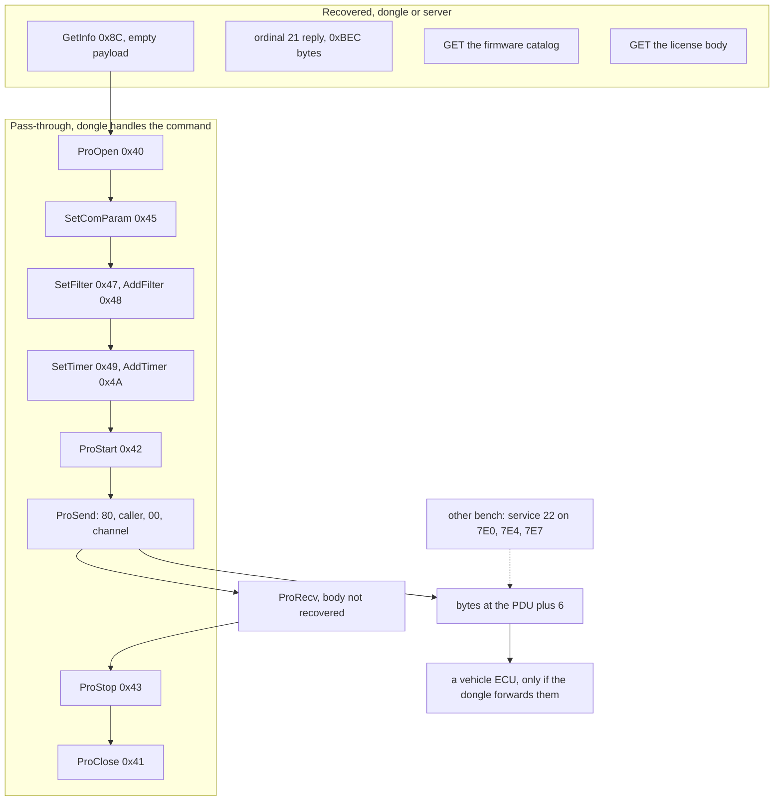

# Reads

What has to be read before a brake-module identity can be named, and which of those
reads this crate already performs. No step here was sent for this note. COM4 was
not opened. No erase, no security seed, and no vehicle write.

SAE J2534 is not imported. ISO 14229-1:2013, ISO 15765-2:2016, and ISO 15031-3:2004
are present in `primarysource`. They were not the source of the layouts below.
The layouts were read from `vcx-reconstructed.dll` (image base `0x7B2F0000`) and
from `ManagerCenter.exe` (image base `0x400000`). A byte that those two programs
do not contain is marked theory, and it is not a frame.

The solid boxes are recovered command layouts. The dashed edge is the other bench.
`ManagerCenter.exe` loads every `VCX_PRO_*` name in `FUN_00427380` and the
cross-references of those stored pointers are writes. The manager does not call
them. The brake-module identity row in [ROADMAP.md](../ROADMAP.md) is still open.

## Device reads

These are already implemented. None of them is a vehicle module.

| Read | Bytes | Who answers | Where it was recovered |
|---|---|---|---|
| `GetInfo` `0x8C` | Empty payload. Header `80 00 8C 00`. | The dongle. The logged fields are in [sources.md](sources.md). | `VCX_DEV_GetInfo`, and a live reply on 2026-11-20. |
| On-device license | The reply buffer is `0xBEC` bytes. The request command byte was not recovered. Ordinal 21 does not call `VCXCommSendFrame` by a direct call. | The dongle. | The buffer layout is `parse_license_info`. The request frame is not. |
| Firmware catalog | `GET https://www.vxdiag.net/managecenter/fws.xml`. Not a serial frame. | The server. | `FirmwareURL` in the manager. Implemented. |
| Server license | `GET {LicenseServerURL}/devices/{id}/license`. The body field `result.license` is hex. On 2026-11-20 that hex was 4076 bytes. | The server. | The manager. Implemented. Not written back. |

Ordinals 20 and 22 are not reads. Their command bytes were not recovered, so this
crate does not build a license write or the `0x1100`-byte `0xFF` erase. That gap
is the license section of [protocol.md](protocol.md).

## Pass-through commands

Header byte 0 is `0x80`. Byte 1 is `0x00` except for `VCX_PRO_Send`. Byte 2 is the
command. Byte 3 is the caller's channel. The DLL does not name the channel or the
integers it copies. The names in the table are the export names. The dongle is the
module that receives the command. A vehicle ECU is not the module that receives
`ProOpen`, `SetComParam`, a filter, a timer, `ProStart`, `ProStop`, or `ProClose`.

| Export | Address | Payload, recovered from the function |
|---|---|---|
| `VCX_PRO_Open` | `0x7B2F5A60` | 4 bytes. The third argument, stored big-endian. |
| `VCX_PRO_Close` | `0x7B2F5BA0` | Empty. |
| `VCX_PRO_Start` | `0x7B2F5CD0` | 1 byte, the third argument. |
| `VCX_PRO_Stop` | `0x7B2F5E10` | Empty. |
| `VCX_PRO_SetComParam` | `0x7B2F5F40` | See below. |
| `VCX_PRO_SetFilter` | `0x7B2F6140` | 1 byte, the third argument. |
| `VCX_PRO_AddFilter` | `0x7B2F6280` | See below. |
| `VCX_PRO_SetTimer` | `0x7B2F6480` | 1 byte, the third argument. |
| `VCX_PRO_AddTimer` | `0x7B2F65C0` | See below. |
| `VCX_PRO_Send` | `0x7B2F5740` | Header `80`, a caller byte, `00`, the channel. Payload below. |
| `VCX_PRO_Recv` | `0x7B2F58E0` | Not recovered. The body is the two calls `FUN_7b585b66` and `FUN_7b44679c`. |
| `VCX_PRO_GetComParam` | `0x7B2F60F0` | No frame. A null device returns `0x80`. Otherwise the function returns 0. |
| `VCX_PRO_Clear` | `0x7B2F67A0` | No frame. It clears dwords in the block at `device+0x24`. |

`SetComParam` reads a count from argument byte 0. The payload length is `count * 6`.
Each record is 8 bytes, starting at argument offset 4. On the wire each record is
6 bytes: the `u16` at record+0 stored big-endian, then the `u32` at record+4
byte-reversed. Record bytes 2 and 3 are not copied.

`AddFilter` reads a count from argument byte 0. Argument bytes 1, 2, and 3 are
not copied. Records start at offset 4 and are `0x34` bytes apart. Each record
contributes four bytes, at record+0, record+4, record+8, and record+12. The dword
at record+4 selects trailing copies, each of `record+12` bytes: one copy from
record+`0x0D` when the dword is at least 0, another from record+`0x19` when it is
at least 1, and another from record+`0x25` when it is at least 2.

`AddTimer` reads the count from the dword at offset 0. The first payload byte is
the low byte of that dword, and the loop runs for the whole dword. Records start
at offset 4 and are `0x28` bytes apart. Each record contributes its first four
bytes and then the dword at record+4, copied as a little-endian dword. When
record byte 2 is nonzero, that many bytes are copied from record+8. When record
byte 3 is nonzero, that many bytes are copied from record+`0x18`.

`VCX_PRO_Send` does not call the receive function. It sets `device+0x1C` to 1;
the other `VCX_PRO_*` senders set that dword to 0. The PDU argument is a `u32` at
offset 0, a `u16` length at offset 4, and that many bytes at offset 6. The length
must be at most `0x1020`. The payload is the `u32` byte-reversed, the `u16`
stored big-endian, and then those bytes. The bytes at offset 6 are the only bytes
in this set that could be forwarded past the dongle. No brake-module request was
found in either program. Search of both programs for `brake`, `ABS`, `EBCM`, and
`7E0` found no vehicle frame. The `identity` hit in `ManagerCenter.exe` is the
Windows manifest's `assemblyIdentity`.

`VCX_PRO_Recv` would be the read of whatever the dongle returned after a send.
Its layout was not recovered. A brake-module identity reply cannot be parsed
until that body is.

## The open row

The brake-module identity read, with no security seed and no write, is this
sequence and nothing past it:

1. The device reads above, so the dongle on the port is the one already identified.
   Those reads do not address a brake module.
2. `ProOpen`, `SetComParam`, the filter commands, the timer commands, and
   `ProStart`, with the layouts above. The integers those functions copy are not
   in either program, so a concrete channel open is not yet a frame.
3. `VCX_PRO_Send` of a PDU whose prefix is recovered and whose bytes at offset 6
   are not. Those unrecovered bytes are the ones a vehicle ECU would see, and
   only if the dongle forwards them. Which ECU, and which request, is not in
   `VCX.dll` or `ManagerCenter.exe`.
4. `VCX_PRO_Recv` for the reply. Not recovered.
5. `ProStop` and `ProClose`, empty payloads, the dongle.

Step 3 is the open row. It stays open because the inner bytes are not recovered.
Inventing them would be a frame this note does not have.

## Theory, the other bench

The Voltage/obdhub bench is a different project. On that bench a module read is
often service `$22`, and the headers in use include `7E0`, `7E4`, and `7E7`.
That is a theory of what a pass-through payload often is. It is not a layout from
this dongle, and it is not a frame to send. `$27` on that bench is a security
seed and stays out of this plan.

## What is still not a frame

- The ordinal 21 request, the ordinal 20 gate, the ordinal 22 write, and the
  `0xFF` erase.
- `VCX_PRO_Recv`.
- The third argument of `ProOpen`, `ProStart`, `SetFilter`, and `SetTimer`, beyond
  "the DLL stores this integer".
- The bytes at a Send PDU's offset 6.
- The boot-mode poll's starting count, the `WrSerial` pointer, and the indirect
  slots `[0x7B2FE0B4]` and `[0x7B2FE13C]`, which belong to the update in
  [protocol.md](protocol.md) and are not vehicle reads.
