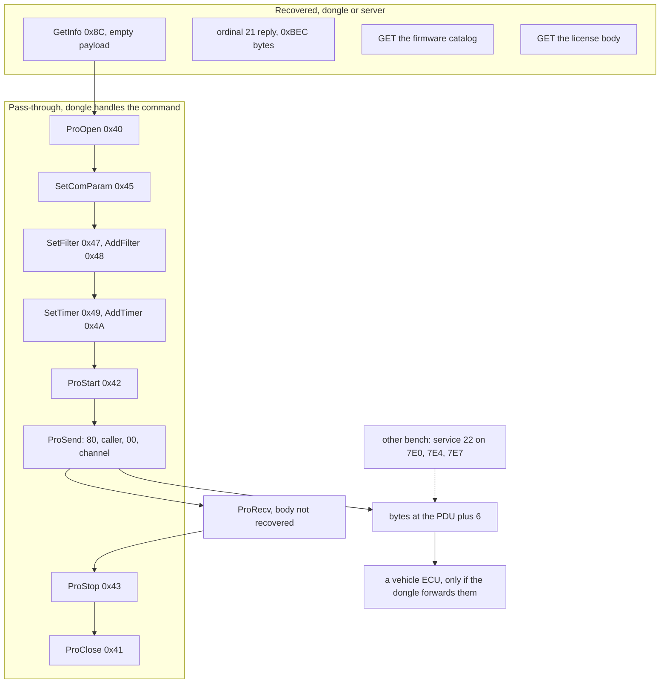

# Reads

What has to be read before a brake-module identity can be named, and which of those
reads this crate already performs. No step here was sent for this note. COM4 was
not opened. No erase, no security seed, and no vehicle write.

SAE J2534 is not imported. ISO 14229-1:2013, ISO 15765-2:2016, and ISO 15031-3:2004
are present in `primarysource`. They were not the source of the layouts below.
The layouts were read from `vcx-reconstructed.dll` (image base `0x7B2F0000`) and
from `ManagerCenter.exe` (image base `0x400000`). A byte that those two programs
do not contain is marked theory, and it is not a frame.

The solid boxes are recovered command layouts. The dashed edge is the other bench.
`ManagerCenter.exe` loads every `VCX_PRO_*` name in `FUN_00427380` and the
cross-references of those stored pointers are writes. The manager does not call
them. The brake-module identity row in [ROADMAP.md](../ROADMAP.md) is still open.

## Device reads

These are already implemented. None of them is a vehicle module.

| Read | Bytes | Who answers | Where it was recovered |
|---|---|---|---|
| `GetInfo` `0x8C` | Empty payload. Header `80 00 8C 00`. | The dongle. The logged fields are in [sources.md](sources.md). | `VCX_DEV_GetInfo`, and a live reply on 2026-11-20. |
| On-device license | Ordinal 21 sends `GetInfo`, then header `80 00 A0 00` with eight payload bytes, then header `80 00 83 00` with an empty payload. The `0xA0` reply is status `0x00`, eight bytes, and a checksum. The `0x83` reply is one byte plus `0xBFC` ciphertext bytes. The key is the raw serial plus `reply^secret` modulo `2^64 - 59`, where the eight request bytes are `5^secret` in that modulus. | The dongle. | `license_nonce`, `license_key_half`, and `decrypt_license`. `read_license` sends the three frames. |
| Firmware catalog | `GET https://www.vxdiag.net/managecenter/fws.xml`. Not a serial frame. | The server. | `FirmwareURL` in the manager. Implemented. |
| Server license | `GET {LicenseServerURL}/devices/{id}/license`. The body field `result.license` is hex. On 2026-11-20 that hex was 4076 bytes. | The server. | The manager. Implemented. Not written back. |

Ordinals 20 and 22 are not reads. Their command bytes were not recovered, so this
crate does not build a license write or the `0x1100`-byte `0xFF` erase. That gap
is the license section of [protocol.md](protocol.md).

## Pass-through commands

Header byte 0 is `0x80`. Byte 1 is `0x00` except for `VCX_PRO_Send`. Byte 2 is the
command. Byte 3 is the caller's channel. The DLL does not name the channel or the
integers it copies. The names in the table are the export names. The dongle is the
module that receives the command. A vehicle ECU is not the module that receives
`ProOpen`, `SetComParam`, a filter, a timer, `ProStart`, `ProStop`, or `ProClose`.

| Export | Address | Payload, recovered from the function |
|---|---|---|
| `VCX_PRO_Open` | `0x7B2F5A60` | 4 bytes. The third argument, stored big-endian. |
| `VCX_PRO_Close` | `0x7B2F5BA0` | Empty. |
| `VCX_PRO_Start` | `0x7B2F5CD0` | 1 byte, the third argument. |
| `VCX_PRO_Stop` | `0x7B2F5E10` | Empty. |
| `VCX_PRO_SetComParam` | `0x7B2F5F40` | See below. |
| `VCX_PRO_SetFilter` | `0x7B2F6140` | 1 byte, the third argument. |
| `VCX_PRO_AddFilter` | `0x7B2F6280` | See below. |
| `VCX_PRO_SetTimer` | `0x7B2F6480` | 1 byte, the third argument. |
| `VCX_PRO_AddTimer` | `0x7B2F65C0` | See below. |
| `VCX_PRO_Send` | `0x7B2F5740` | Header `80`, a caller byte, `00`, the channel. Payload below. |
| `VCX_PRO_Recv` | `0x7B2F58E0` | Not recovered. The body is the two calls `FUN_7b585b66` and `FUN_7b44679c`. |
| `VCX_PRO_GetComParam` | `0x7B2F60F0` | No frame. A null device returns `0x80`. Otherwise the function returns 0. |
| `VCX_PRO_Clear` | `0x7B2F67A0` | No frame. It clears dwords in the block at `device+0x24`. |

`set_com_param`, `add_filter`, and `add_timer` build these payloads and do not send them.
`close_payload` and `stop_payload` are empty. `start_payload` is the single byte `0`.
`set_filter_payload` and `set_timer_payload` are the single byte `1` or `2`. Any other
byte is refused. `VCX_PRO_Recv` still has no body.

`SetComParam` reads a count from argument byte 0. The payload length is `count * 6`.
Each record is 8 bytes, starting at argument offset 4. On the wire each record is
6 bytes: the `u16` at record+0 stored big-endian, then the `u32` at record+4
byte-reversed. Record bytes 2 and 3 are not copied.

`AddFilter` reads a count from argument byte 0. Argument bytes 1, 2, and 3 are
not copied. Records start at offset 4 and are `0x34` bytes apart. Each record
contributes four bytes, at record+0, record+4, record+8, and record+12. The dword
at record+4 selects trailing copies, each of `record+12` bytes: one copy from
record+`0x0D` when the dword is at least 0, another from record+`0x19` when it is
at least 1, and another from record+`0x25` when it is at least 2.

`AddTimer` reads the count from the dword at offset 0. The first payload byte is
the low byte of that dword, and the loop runs for the whole dword. Records start
at offset 4 and are `0x28` bytes apart. Each record contributes its first four
bytes and then the dword at record+4, copied as a little-endian dword. When
record byte 2 is nonzero, that many bytes are copied from record+8. When record
byte 3 is nonzero, that many bytes are copied from record+`0x18`.

`VCX_PRO_Send` does not call the receive function. It sets `device+0x1C` to 1;
the other `VCX_PRO_*` senders set that dword to 0. The PDU argument is a `u32` at
offset 0, a `u16` length at offset 4, and that many bytes at offset 6. The length
must be at most `0x1020`. The payload is the `u32` byte-reversed, the `u16`
stored big-endian, and then those bytes. The bytes at offset 6 are the only bytes
in this set that could be forwarded past the dongle. No brake-module request was
found in either program. Search of both programs for `brake`, `ABS`, `EBCM`, and
`7E0` found no vehicle frame. The `identity` hit in `ManagerCenter.exe` is the
Windows manifest's `assemblyIdentity`.

`VCX_PRO_Recv` would be the read of whatever the dongle returned after a send.
Its layout was not recovered. A brake-module identity reply cannot be parsed
until that body is.

## The open row

The brake-module identity read, with no security seed and no write, is this
sequence and nothing past it:

1. The device reads above, so the dongle on the port is the one already identified.
   Those reads do not address a brake module.
2. `ProOpen`, `SetComParam`, the filter commands, the timer commands, and
   `ProStart`, with the layouts above. The integers those functions copy are not
   in either program, so a concrete channel open is not yet a frame.
3. `VCX_PRO_Send` of a PDU whose prefix is recovered and whose bytes at offset 6
   are not. Those unrecovered bytes are the ones a vehicle ECU would see, and
   only if the dongle forwards them. Which ECU, and which request, is not in
   `VCX.dll` or `ManagerCenter.exe`.
4. `VCX_PRO_Recv` for the reply. The export is virtualized. The copy out of
   its PDU is recovered and is below.
5. `ProStop` and `ProClose`, empty payloads, the dongle.

Step 3 is the open row. It stays open because the inner bytes are not recovered.
Inventing them would be a frame this note does not have.

## What the pass-through copies

`VCXPT32.dll` is the caller `ManagerCenter.exe` is not. `PassThruWriteMsgs`
(`0x100039e0`) does not contain a module request. `FUN_10005df0` refuses a data
length above `0x1020`, writes the flags dword and that length, and copies the
caller's bytes to PDU offset 6. `VCX_PRO_Send` (`0x7B2F5740`) stores the dword
big-endian, the length big-endian, and then those bytes. `send_payload` builds
that payload. It does not transmit it.

`PassThruConnect` (`0x100035e0`) calls `VCX_PRO_Open` with the dword
`FUN_10005a20` returns, then `VCX_PRO_SetComParam`, `VCX_PRO_SetFilter` with
third argument 1, and `VCX_PRO_Start` with third argument 0. The logged names
and the dwords are:

| Caller protocol | Log name | `VCX_PRO_Open` dword |
|---|---|---|
| 1, `0x8000` | `VCX_PROTOCOL_J1850_VPW` | `0x8505` |
| 2, `0x8001` | `VCX_PROTOCOL_J1850_PWM` | `0x8606` |
| 3, `0x8002` | `VCX_PROTOCOL_ISO9141_UART` | `0x9104` |
| 4, `0x8003` | `VCX_PROTOCOL_ISO14230_UART` | `0x9004` |
| 5, `0x8004`, `0x8008`, `0x800f` | `VCX_PROTOCOL_ISO11898_CAN` | `0x8101` |
| 6, `0x8005`, `0x8007`, `0x8010`, `0x10000` | `VCX_PROTOCOL_ISO15765_CAN` | `0x8001` |
| 7, 8, 9, 10 | `VCX_PROTOCOL_J2610_SCI` | `0x8a0a` |
| `0x800a`, `0x10004` | `VCX_PROTOCOL_KW1281_UART` | `0x9204` |
| `0x800b`, `0x10003` | `VCX_PROTOCOL_DIAGH_UART` | `0x9104` |
| `0x800e` | `VCX_PROTOCOL_TP20_CAN` | `0x8401` |
| `0x80000001`, `0x80000002` | `VCX_PROTOCOL_LIN_UART` | `0x9d04` |

For ISO 15765 the copied bytes are unchanged, and the flags dword receives bits
from the caller's flag word. For J1850, `FUN_10005ce0` appends one inverted
check byte. For the UART protocols, when flag `0x200` is clear, `FUN_10005c10`
appends the sum of the data bytes. A brake-module identity would be those copied
bytes. This DLL does not contain them. The dongle is still the module that
receives `VCX_PRO_Send`. An ECU sees the copy only if the dongle forwards offset 6.

When the message protocol differs from the channel protocol, `FUN_10005df0`
sets PDU bit 0 and logs `CAN_MIXED_FORMAT` only if channel `+0xa4` is set, the
channel id is one of the ISO 15765 ids, and the message id is one of the raw
CAN ids. Every other mismatch returns `0x15` and does not finish the copy.
`mixed_bit` is that bit.

Connect's `SetComParam` buffer is one record: count `1`, key `3`, value the
caller's baud. `baud_record` is that record. `SetFilter`'s third argument is
`1` on connect and `2` for `CLEAR_MSG_FILTERS`. `Start`'s third argument is
`0`, and protocols `0x8000` through `0x8011` and `0x80000002` skip that call.
`AddFilter` copies the caller's pattern, mask, and flow-control bytes. When
the mask flag `0x100` is set, pattern byte 0 is ORed with `0x80`. No constant
module id is in those buffers.

`SET_CONFIG` (`FUN_10005840`) replaces that one record with the list
`config_records` builds. ISO 9141 multiplies the connect defaults by 500,
1000, or 2000. ISO 15765 ends with key `0x23`, value `4`, and adds key
`0x8001`, value `2`, when channel `+0x154` is not 0. A pin word of `0x060E`
forces key `0x100` to 0. Protocol `0x800E` stores key `0x100` as 0 when the pin word is `0x060E`.
Any other pin word leaves that dword unchanged, so the record is not built.
A later `0x8405` record sits outside the count the packer sends. LIN has no
builder, so the buffer already stored is sent again. The connect default at
`+0xa8` is a zero dword, which clears `+0xa9` too.

## What a read copies back

`VCX_PRO_Recv` at `0x7B2F58E0` is `jmp 0x7B73BB48`, and that address is in
section `.V0`. The body was not recovered.
`VCXPT32` calls it from the event callback `FUN_10006a40` when the callback's
second argument is `1`. The PDU it returns is parsed by `FUN_10006070`: a
little-endian flags dword at offset 0, a little-endian `u16` length at offset 4,
and that many bytes at offset 6. `PassThruReadMsgs` then copies one queued
record. It does not call `VCX_PRO_Recv` itself.

`rx_status` is the flag map. `delivered_len` is the trailing-byte drop:
protocols `1` and `0x8000` lose one byte, `2` and `0x8001` lose two when the
length is at least 2, and the UART protocols lose one when channel flag `0x200`
is clear. A UART drop that leaves 0 is not queued. ISO 15765 keeps its bytes.
PDU bit 0 rewrites protocols `6` and `0x10000` to `5`. The bytes at offset 6
are still whatever `VCX_PRO_Recv` wrote.

`periodic_timer` is the `AddTimer` record. The first copied tail is the
byte-swapped flag dword and then the same data `copied_data` would place at
PDU offset 6. The interval is stored times `0x3E8`. Stopping a timer sends a
zero record whose slot is the id minus 1, and does not call `SetTimer`.

`VCXPT32` resolves ordinals 20, 21, and 22 and never calls them. Ordinals
`0x17`, `0x31`, `0x32`, and `0x33` are called from `PassThruOpen` and
`PassThruConnect`. Their buffers are a dword plus 8 bytes, a callback plus a
dword, a dword and an 8-byte global, and that global plus a 16-byte slot.
The ordinal bodies are not in this DLL.

## Theory, the other bench

The Voltage/obdhub bench is a different project. On that bench a module read is
often service `$22`, and the headers in use include `7E0`, `7E4`, and `7E7`.
That is a theory of what a pass-through payload often is. It is not a layout from
this dongle, and it is not a frame to send. `$27` on that bench is a security
seed and stays out of this plan.

`READ_VBATT` writes 14000 and then calls `VCX_DEV_GetPinVol` with middle
argument `0x10`. Success replaces 14000 with the first dword that call writes.
Failure stores 0. `PassThruSetProgrammingVoltage` forwards the caller's pin
and voltage to `VCX_DEV_SetPinVol` and adds no bytes of its own. `SET_PIN_USE`,
`READ_PROG_VOLTAGE`, `CAN_SET_BTR`, and `FIVE_BAUD_INIT_NO_INV_KB2` return
success and call no device function. `FIVE_BAUD_INIT` sends one caller byte with flags 8.
`FAST_INIT` accepts the UART protocols `3`, `4`, `0x8002`, `0x8003`, `0x10003`,
and `0x800b`, runs the normal copy, and sets flag `0x4`. A different message
protocol returns `0x0A`. Any other protocol returns 1. Both pass timeout
`0x3E8` to `VCX_PRO_Send`.

## What is still not a frame

- The ordinal 20 gate, the ordinal 22 write, and the `0xFF` erase. The
  `GetLicense` request, the `80 00 A0 00` exchange, and the eight key bytes
  are recovered.
- The bytes `VCX_PRO_Recv` writes at PDU offset 6.
- The third argument of `ProOpen`, beyond the protocol dword `open_code` returns.
  `ProStart` is `0` when connect calls it. `SetFilter` is `1` or `2`.
  `SetTimer` is `1` or `2`.
- The caller's data bytes at a Send PDU's offset 6. The prefix, the flag map,
  the mixed-format bit, and the trailing check byte are packed.
- The word `FIVE_BAUD_INIT` copies out of a queued message. That word is
  whatever arrived, not a constant.
- The `0x800E` phase record when the pin word is not `0x060E`. The builder does not store it.
- The boot-mode poll's starting count, the `WrSerial` pointer, and the indirect
  slots `[0x7B2FE0B4]` and `[0x7B2FE13C]`, which belong to the update in
  [protocol.md](protocol.md) and are not vehicle reads.
