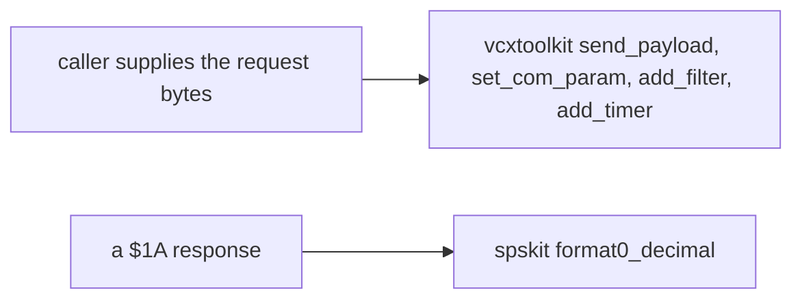

# Who talks to the tool

`vcxtoolkit` and `spskit` (`D:\code\spskit`) split the native stack. This crate does not post an SPS request. The same split is in `spskit`'s `docs/tool-boundary.md`.

## This crate

`vcxtoolkit` owns the dongle: the serial frame, `GetInfo`, the license, and the firmware catalog. A later vehicle read is `docs/reads.md`, the `VCX_PRO_*` commands, not the fifteen `PassThru*` exports. It does not load a GM wrapper, write `HKLM\SOFTWARE\GM\J2534Wrapper`, or build a programming-data body.

If real Techline Connect must see a device, this crate is the one that would write `HKLM\SOFTWARE\PassThruSupport.04.04\<product> - J2534` (and the `Wow6432Node` twin) with `FunctionLibrary` pointing at a pass-through DLL, `APIVersion` `04.04`. The existing PASSTHRU installer already does that, including a second key tail `Bosch - MDI` for the same DLL. That pass-through DLL now has a home: the `vcxtoolkit-j2534` workspace member (`j2534/`) scaffolds the `PassThru*` exports and builds the `PassThruSupport.04.04` record as data (`docs/j2534.md`). It still does **not** write that key — `registry.rs` builds the install plan and holds it, the real write is an owner-run step — and the channel-bearing exports return a pending status because the native vehicle exchange is unproven. The exports are grounded in SAE J2534-1 (available through `primarysource`) and the ISO 22900-2:2009 D-PDU API.

`VCX_SetEventCallback` is export 5 of `VCX.dll`. It is a device-SDK hook for this side, not a registration call into Techline.

## spskit

`spskit` builds the SPS request from a saved module read. `wrapper.parse_init()` classifies the connect string, and `vit1.format0_decimal()` reads a service `$1A` response. It does not open a COM port. `j2534bridge.dll` was not found on this machine. `spsvcs.dll` exports `GetDefaultDeviceInfo`, `ClearDefaultDeviceInfo`, `GetConnectedDeviceInfo`, and `GetDeviceStatus` as its own API, and its Init also resolves those names on the missing wrapper. That hop stays unassigned.

The three payload builders copy the recovered argument layout and do not open a port. The request bytes stay the caller's. `format0_decimal` reads a response that is already in hand.
